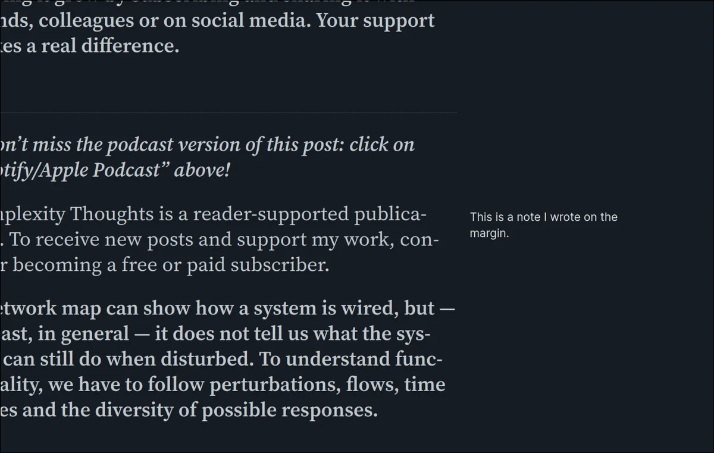

# Session 3: Palette, typography, density, vibe

Claude Design · Design · 5 prompts · 354 words

[← Session 2](02-quick-and-ugly-wireframes.md) · [All sessions](README.md) · [Session 4 →](04-first-foldable-contents-component.md)

## Prompt 9

**Summary:** Kick off a session to decide the app's overall visual style: light/dark palette, typography, density, and vibe, using a Readwise Reader screenshot as a model for minimal, hover-revealed UI chrome.

- **Phase:** Design
- **Human:** 202 words · ~5 min to write · 1 image · 1 file
- **LLM:** Fable 5 · Claude Design · 43 s · +195 −0 lines
- **Outcome:** constraint, decision

### Prompt

> Now that the wireframes look good, I want to move on to defining the actual UI in detail. In this session, I want to focus on defining the overall style, without worrying too much about the detailed shapes/positioning/contrast.
>
> Goal of this session: decide a light/dark color palette, typography,  information density, and vibe of the app.
>
> My starting requests:
> - I want this to feel sleek and minimal. Very few moving parts, "don't make me think". The book is always the protagonist. The rest should be able to fade into the background.
> - It should feel serious but inspired, not over-the-top, definitely not "high-tech" or flashy.
> - It should feel true to Wittgenstein's attitude.
> - Simple, but also self-explanatory UI.
>
> By the way, this screenshot from Readwise Reader shows you how the margin notes look like there, which I love because they implement the minimal-UI style I'm aiming for: literally just the text is shown, small and inconspicuous. Only when you hover it with the mouse and/or have your caret there to write does a bit more UI become visible. That's the spirit: UI is there only when you need it, but when you do need it it's ready for you and simple.

### Reply of Claude Design

**Questions of the AI:**

1. Typeface for the statements themselves
   - Options: Classic book serif (e.g. a Garamond/Caslon feel — like the printed Tractatus) · Modern literary serif (e.g. Source Serif / Lora — like Readwise Reader) · Quiet grotesque sans (Swiss, very Wittgenstein-adjacent austerity) · Serif for statements, sans for all UI chrome · Explore a few options · Decide for me · Other
   - **Answer:** Quiet grotesque sans (Swiss, very Wittgenstein-adjacent austerity)
2. The decimal numbers (1, 2.1, 2.11…)
   - Options: Same serif as text, just lighter · Monospace — tabular, technical · Small sans, dimmed · Explore a few options · Decide for me
   - **Answer:** Explore a few options
3. Accent color (pins, search hits, the ONE color)
   - Options: No color at all — pure ink/paper, use weight & underlines only · Muted amber/ochre (aged paper, pencil) · Muted oxblood/red (classic annotation) · Muted blue (cool, logical) · Explore a few options · Decide for me · Other
   - **Answer:** Explore a few options
4. Light & dark themes
   - Options: Design both from the start (like your Readwise screenshot) · Light first, dark later · Dark first — it's my primary mode · Decide for me
   - **Answer:** Design both from the start (like your Readwise screenshot)
5. Information density
   - Options: Airy — generous line spacing, book-like, less on screen · Compact — more of the tree visible at once · Middle — comfortable but efficient · Explore a few options · Decide for me
   - **Answer:** Airy — generous line spacing, book-like, less on screen
6. Background tone (light theme)
   - Options: Warm paper white (cream/ivory) · Neutral white, barely toned · Cool grey-white · Decide for me
   - **Answer:** Neutral white, barely toned
7. How invisible should chrome be at rest?
   - Options: Radically invisible — almost nothing until hover, like Readwise notes · Ghosted — faintly visible so it stays discoverable · Small but solid — always legible, just tiny · Explore a few options · Decide for me
   - **Answer:** Radically invisible — almost nothing until hover, like Readwise notes
8. What should I produce this session?
   - Options: Style tiles — same one screen rendered in 2–3 candidate styles, side by side · One high-fidelity screen in a single proposed style, then iterate · A mini style guide (palette, type scale, states) + one sample screen · Decide for me
   - **Answer:** Style tiles — same one screen rendered in 2–3 candidate styles, side by side
9. Any explicit nod to the 1922 book?
   - Options: None — spirit only, no pastiche · Subtle — e.g. old-style figures, restrained title page feel · Explore a few options · Decide for me
   - **Answer:** Subtle — e.g. old-style figures, restrained title page feel
10. Anything else about the vibe?

Three style tiles are up in **Tractatus Style Tiles.dc.html**, each with light + dark and a palette/type spec strip:

- **1a Ink** — Helvetica, zero color: search hits underlined, pins = weight + dot
- **1b Pencil** — Hanken Grotesk light on warm paper, monospace numbers, one muted ochre wash
- **1c Oxblood** — Schibsted Grotesk on cool neutrals, small dimmed numbers, oxblood underline; dark theme matches your Readwise slate

All three share the agreed constants: airy spacing, chrome at ~13% opacity until hover (1.11 shows the hover state), bare margin notes, plain-number counts, and a single letterspaced-title + hairline as the only 1922 nod.

Pick one — or a mix (e.g. 1b's mono numbers on 1a's monochrome) — and I'll lock the system.

*The prototype after this reply (screenshot, not included): The prototype "Tractatus Style Tiles": three style options, Ink, Pencil and Oxblood, each shown in a light and a dark theme. Every tile shows the same few Tractatus statements with a margin note.*

## Prompt 10

**Summary:** Confirm option 1b and ask for more UI elements in that style, loosely, to build toward a design system.

- **Phase:** Design
- **Human:** 45 words · ~1 min to write
- **LLM:** Fable 5 · Claude Design · 2 min 25 s · +219 −1 lines
- **Outcome:** decision, constraint, feature designed

### Prompt

> 100% 1b. Now show me more UI elements in that same style. Don't worry about the exact structure of the elements, I just want a feel of the styling. The goal of this session is to create a little design system to guide further steps.

### Reply of Claude Design

Turn 2 is up at the top of the canvas — a mini design system for "Pencil":

- **2a Tokens** — palette (paper/ink/ochre ×2 themes), the four ink opacity levels (100/45/24/14%), type scale, surface rules
- **2b Components, light** — buttons (text-first, hairline = emphasis), icon actions at rest vs hover, line-not-box inputs, term chip, toggles, menu, tooltip, note in its three states (rest/hover/editing), save dialog, undo toast, empty state
- **2c Components, dark** — same rules mirrored; toast and tooltip invert

Core rules stated on the canvas: text before boxes, hairlines before fills, one accent used sparingly, chrome at 14% ink until hover, shadows only on overlays.

Next natural step: apply this to a full hi-fi main view, or define motion (fold/unfold, hover fades).

*The prototype after this reply (screenshot, not included): The prototype "Tractatus Style Tiles": a new design-system sheet on top shows color tokens and type scale, then sample buttons, inputs, menus and notes in light and dark themes. The style tiles follow below.*

## Prompt 11

**Summary:** Give specific corrections: reduce the number of ink levels, set 24% as minimum opacity, and make margin notes bigger and more visible with a specific hover/editing state mapping.

- **Phase:** Design
- **Human:** 52 words · ~1 min to write
- **LLM:** Fable 5 · Claude Design · 1 min 41 s · +18 −19 lines
- **Outcome:** constraint, correction, UX improved

### Prompt

> Too many ink levels, and the 14% is not visible enough. 24% is the minimum acceptable.
>
> Margin note should be  as big as the UI text, and more visible. The current "hover state" is the right level of visibility at rest. When hovering, make it the same as the current "editing" state.

### Reply of Claude Design

Updated:

- Ink levels collapsed to three: 100% statements · 60% secondary (notes, numbers, labels) · 24% floor (chrome at rest, folded, disabled). The 14% tier is gone; icon actions at rest now sit at 24%.
- Margin notes: now 14px. Rest = 60% ink bare text; hover = ochre rule + full ink (the old editing look); editing = same + caret & autosave microtext. Both themes.

Note the fold arrows inside the turn-1 tiles still show the old 14% chrome — I left turn 1 as history; the token card in 2a is now the source of truth.

*The prototype after this reply (screenshot, not included): The prototype "Tractatus Style Tiles": the design-system sheet sits above the three style tiles. It shows tokens, sample controls and margin notes in light and dark themes.*

## Prompt 12

**Summary:** Reject the current icons as unclear and unliked, and ask for a fitting, expressive icon font for the app's functions.

- **Phase:** Design
- **Human:** 41 words · ~1 min to write · 1 file
- **LLM:** Fable 5 · Claude Design · 40 s · +11 −11 lines
- **Outcome:** decision, UX improved, bug reported

### Prompt

> Last we need to work on the icons. I don't understand what these icons are meant to represent, and anyway I don't like them. We need a nice and fitting icon font that is properly expressive for the functions I need.

### Reply of Claude Design

Icon font swap is done and verified clean — no more open tasks this session.

*The prototype after this reply (screenshot, not included): The prototype "Tractatus Style Tiles": the design-system sheet of tokens, sample controls and notes in light and dark themes, above the three style tiles.*

## Prompt 13

**Summary:** Approve the current direction and ask to save a design system based on the #2 style set (2a-2c).

- **Phase:** Design
- **Human:** 14 words · ~21 s to write
- **LLM:** Fable 5 · Claude Design · 40 s
- **Outcome:** docs written, process

### Prompt

> Perfect. Now save a design system based on this #2 set of styles (2a-2c)

### Reply of Claude Design

Saved as **Tractatus Design System.dc.html** — tokens, ink levels, type scale, and the full light/dark component sampler, locked as the standing reference.

---

[← Session 2](02-quick-and-ugly-wireframes.md) · [All sessions](README.md) · [Session 4 →](04-first-foldable-contents-component.md)
