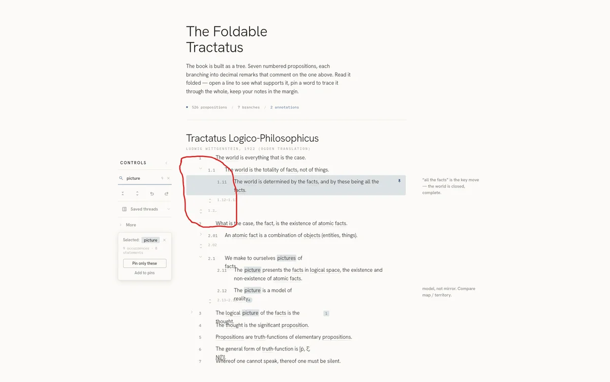

# Session 11: Gap audit and task list

Claude Design · Design · 8 prompts · 188 words

[← Session 10](10-header-retitle.md) · [All sessions](README.md) · [Session 12 →](12-undo-toast.md)

## Prompt 50

**Summary:** Ask the agent to audit the current design against the docs and identify any element, part, or interaction that was never designed.

- **Phase:** Design
- **Human:** 17 words · ~26 s to write
- **LLM:** Fable 5 · Claude Design · 56 s
- **Outcome:** verification, question answered, bug reported, decision

### Prompt

> The design has really come together. Did we forget to design any element/part/interaction mentioned in the docs?

### Reply of Claude Design

Good — the design is well covered. I audited it against the spec and the component docs. A few things in the docs never got designed:

**Missing — significant**
- **The focused / "folded-with-pins" view (spec §5).** This is called out as *"the app's signature reading mode,"* with its four derived display states — **Full / Peek / Collapsed / Hidden**. The current design only has manual expand/collapse; there's no Peek treatment and no derived focus view when you fold-all with pins present. Open question #1 (how quiet a peek is) was meant to be settled in design — it isn't shown anywhere.
- **The undo toast (spec §12, components.md).** The component doc explicitly describes a **dark toast — "the one inverted element in the system"** — as the immediate undo affordance for pin-replacing actions. The design uses a confirm *modal* for "Pin only these" instead, and there's no toast anywhere. Neither the toast nor an "undo" affordance appears after isolate/pin-replace.

**Missing — smaller**
- **Per-statement isolate control (spec §4)** — every statement is supposed to have its own "focus on this only" control (the deep-link mechanism). Rows currently have toggle / note / pin, but no per-row isolate. "Pin only these" exists only on the term card.
- **Cross-reference in-place preview (spec §10)** — interactive statement→statement references with a hover/click preview. Not present (the curated subset may also not include any reference text to hang it on).
- **Keyboard navigation (spec §12)** — arrows + j/k to move between statements, keys for expand/fold/pin. Only the `/` search hint is shown.
- **Export formats (spec §8)** — the menu offers *Markdown* and *PDF*, but the spec's three formats are **Markdown, HTML (styled), JSON (round-trip)**. PDF isn't in the spec; HTML and JSON are missing.

**Deliberately deferred, not gaps:** cloud sync UI (§7 is opt-in/backend), and the empty-state pattern (README lists it as an intentionally-deferred composite).

The biggest one to decide on is the **focused peek view** — it's the signature interaction and currently has no design at all. Want me to design that (and the undo toast) next?

## Prompt 51

**Summary:** Record the just-identified missing design items into a new task list file.

- **Phase:** Design
- **Human:** 10 words · ~15 s to write
- **LLM:** Fable 5 · Claude Design · 24 s · +39 −0 lines
- **Outcome:** docs written, process

### Prompt

> Write these missing items into a task list file now

### Reply of Claude Design

Written to `TODO — Missing from spec.md` — two significant items (focused peek view, undo toast), four smaller ones, plus the two deferred-not-gaps noted at the bottom.

## Prompt 52

**Summary:** Design the Peek state's visual appearance and its expand interaction only, without wiring the full pinned/peek/full folding logic yet.

- **Phase:** Design
- **Human:** 39 words · ~59 s to write
- **LLM:** Fable 5 · Claude Design · 4 min 25 s · +61 −35 lines
- **Outcome:** constraint, feature designed, feature built

### Prompt

> Implement the Peek state next. No need to set up the full folding logic handling pinned vs peek vs full. I just want to see what peek items would look like, and how the interaction to expand them works.

### Reply of Claude Design

Done.

*The prototype after this reply (screenshot, not included): The prototype "Foldable Tractatus": some statements not matching the selected word "picture" show as faded, shortened one-line previews that end in an ellipsis. Matching and pinned statements stay in full.*

## Prompt 53

**Summary:** Correct the prior peek-state design: per an earlier decision recorded in the docs, peek items should collapse to just numbers, and the agent should redo the work accordingly.

- **Phase:** Design
- **Human:** 20 words · ~30 s to write
- **LLM:** Fable 5 · Claude Design · 5 min 14 s · +70 −23 lines
- **Outcome:** correction, feature designed, feature built, bug fixed

### Prompt

> No, you didn't read the docs. I already decided that peek items should be collapsed to just numbers. Re-do this.

### Reply of Claude Design

Done.

*The prototype after this reply (screenshot, not included): The prototype "Foldable Tractatus": unpinned statements are collapsed into small faint rows that show only their numbers, such as "1.12–1.13" and "2.13–2.14", each with a small expand chevron.*

## Prompt 54

**Summary:** Increase the color contrast of the peek-state numbers, which are now too faint.

- **Phase:** Design
- **Human:** 13 words · ~20 s to write
- **LLM:** Fable 5 · Claude Design · 35 s · +1 −1 lines
- **Outcome:** accessibility, decision

### Prompt

> Better, but they're a bit TOO invisible now. Make the color contrast more

### Reply of Claude Design

Peek numbers and carets are now at 40% ink at rest (100% on hover) — clearly more legible while still sitting quieter than the full-statement numbers. Done.

*The prototype after this reply (screenshot, not included): The prototype "Foldable Tractatus": the collapsed number-only rows, such as "1.12–1.13" and "2.02", are darker and easier to read than before, but still quieter than full statements.*

## Prompt 55

**Summary:** Reuse the existing chevron/unfold icon for peek items instead of whatever icon they currently use.

- **Phase:** Design
- **Human:** 22 words · ~33 s to write
- **LLM:** Fable 5 · Claude Design · 1 min 28 s · +1 −1 lines
- **Outcome:** UX improved, constraint

### Prompt

> also, for peek items should now use the same chevron icon as the fold/unfold action. They should use the "unfold" icon instead.

### Reply of Claude Design

Done — peeks now use the unfold icon.

*The prototype after this reply (screenshot, not included): The prototype "Foldable Tractatus": the collapsed number-only rows, such as "1.12–1.13", now use a small up-and-down "unfold" icon instead of the right-pointing chevron.*

## Prompt 56

**Summary:** Fix the vertical alignment of the fold/unfold icons, the right-side action icons, and the peek-state expand icon, which are all misaligned relative to the item text.

- **Phase:** Design
- **Human:** 53 words · ~1 min to write · 1 image · 2 files
- **LLM:** Fable 5 · Claude Design · 3 min 5 s · +10 −8 lines
- **Outcome:** bug reported, bug fixed, process

### Prompt

> The vertical alignment of the icons is all off. fold/unfold icons are a but too high for the text (relative to the first line of an item) and so are the action icons on the right side of an item. The "expand" icon next to peek-state items is too low. Alignment is important!

### Reply of Claude Design

All icons now sit centered on their target line: the fold chevrons align to each statement's first line, the pin aligns to the first line, and the peek unfold icons center on their number. Fixed.

*The prototype after this reply (screenshot, not included): The prototype "Foldable Tractatus": collapsed number-only rows, such as "1.12–1.13", each with an unfold icon, between full statements with fold arrows. Statement 1.11 is pinned.*

## Prompt 57

**Summary:** Mark the focus/peek implementation task as done in the task list and report what the next task on the list is.

- **Phase:** Design
- **Human:** 14 words · ~21 s to write
- **LLM:** Fable 5 · Claude Design · 35 s · +7 −6 lines
- **Outcome:** docs written, question answered, process

### Prompt

> mark the task of implementing focus/peek as done, and tell me the next up

### Reply of Claude Design

Marked the Peek/focus view done (treatment settled, promote-on-expand working) — with one follow-up noted: deriving peeks from the pin set at runtime rather than the seeded demo set.

**Next up — the other significant item: the Undo toast (spec §12 + components.md).** The dark, inverted toast is called out as *"the one inverted element in the system,"* and it's the immediate undo affordance after pin-replacing actions (isolate, "Pin only these"). Right now that path uses a confirm modal with no post-action undo. It's the last significant gap; after it, only smaller items remain (per-statement isolate, cross-reference preview, keyboard nav, export formats).

Want me to design the undo toast next?

---

[← Session 10](10-header-retitle.md) · [All sessions](README.md) · [Session 12 →](12-undo-toast.md)
