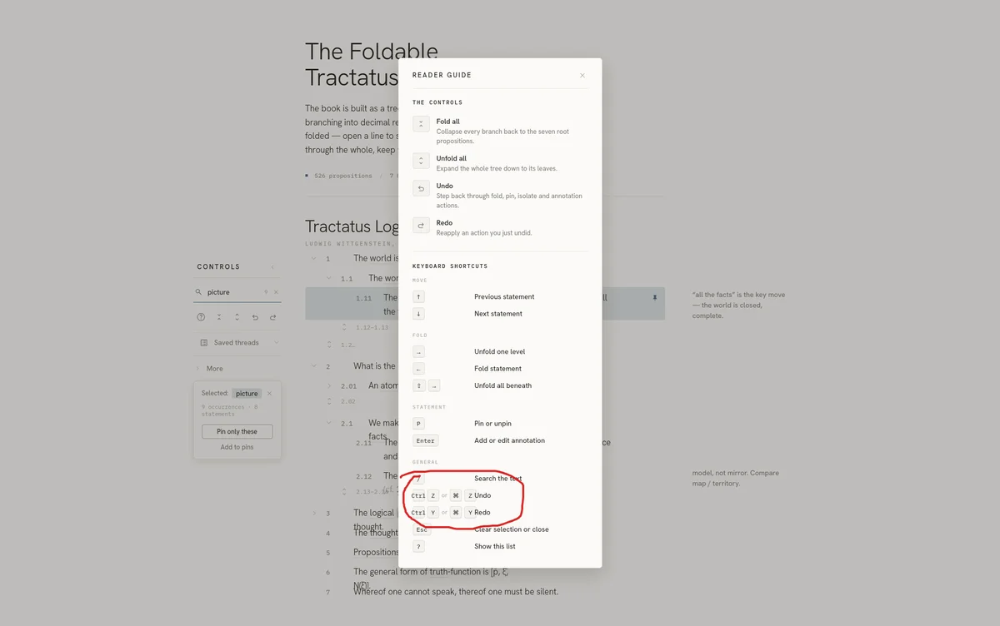

# Session 15: Keyboard-shortcuts modal

Claude Design · Design · 5 prompts · 202 words

[← Session 14](14-cross-reference-preview.md) · [All sessions](README.md) · [Session 16 →](16-export-formats.md)

## Prompt 67

**Summary:** Wants a design-only (non-functional) keyboard-shortcuts help modal: add a question-mark-in-circle icon at the left of the control panel row that opens a modal listing supported shortcuts.

- **Phase:** Design
- **Human:** 86 words · ~2 min to write
- **LLM:** Fable 5 · Claude Design · 2 min 33 s · +118 −38 lines
- **Outcome:** decision, feature designed

### Prompt

> Next we're implementing the next design task: "Keyboard navigation (§12)"
>
> However there is no need to implement the actual functionality here, as this is just a design preview and keyboard navigation is out of scope. What I want to implement is a simple explanation modal showing the keyboard shortcuts that work on the app. Add a question-mark-in-circle icon to the row of icons in the control panel (put it left-most) and when clicking I want a modal to pop up with the list of supported shortcuts.

### Reply of Claude Design

Added a `help` (question-mark) icon as the left-most item in the Controls toolbar. Clicking it — or pressing `?` — opens a keyboard-shortcuts modal grouped into Move / Fold / Statement / General, with styled keycaps and a note that navigation stays inside the reader. Escape or the close button dismisses it. It's a display-only reference; no actual key handling was wired.

*The prototype after this reply (screenshot, not included): The prototype "Foldable Tractatus" with the keyboard shortcuts open: a dialog titled "Keyboard shortcuts" lists keys in groups: move, Fold, Statement and General. A new question-mark icon starts the control row.*

## Prompt 68

**Summary:** Refines the shortcuts modal: remove K/J shortcuts, make Enter trigger annotation edit/create, drop 'isolate' shortcuts, add Ctrl+Z/Ctrl+Y (and Mac equivalents) for undo/redo, add a section explaining the other 4 control-panel icons before the shortcuts list, and make the modal scrollable to cap its height.

- **Phase:** Design
- **Human:** 84 words · ~2 min to write
- **LLM:** Fable 5 · Claude Design · 2 min 28 s · +81 −51 lines
- **Outcome:** decision, feature designed, UX improved

### Prompt

> - Remove the K and J shortcuts
> - The Enter key should trigger an annotation (either edit an existing one or create it if not yet existing).
> - No need for shortcuts to "isolate"
> - Ctrl+Z and Ctrl+Y for undo/redo (and Mac equivalent)
> - Let's put more information in this modal: before the keyboard shortcuts section, add a section explaining briefly what the other 4 icons in the control panel do.
> - Make this modal scrollable so that its height doesn't get too high.

### Reply of Claude Design

Done. Changes to the shortcuts modal:

- Removed the J/K alternatives — Move now shows just ↑ / ↓.
- Enter now maps to "Add or edit annotation"; dropped the separate N shortcut and the isolate row.
- Undo/redo split into two rows: `Ctrl Z` / `⌘ Z` and `Ctrl Y` / `⌘ Y`.
- Added a "The controls" section above the shortcuts explaining the four toolbar icons (fold all, unfold all, undo, redo) with their glyphs and descriptions.
- The modal now caps at 82vh and scrolls, with a sticky header so the title and close button stay visible.

*The prototype after this reply (screenshot, not included): The prototype "Foldable Tractatus" with the keyboard shortcuts open: the scrollable dialog now starts with "The controls", which explains fold all, unfold all, undo and redo. The shortcut groups follow below.*

## Prompt 69

**Summary:** Corrects the modal's name, since it now covers more than just keyboard shortcuts.

- **Phase:** Design
- **Human:** 17 words · ~26 s to write
- **LLM:** Fable 5 · Claude Design · 2 min 14 s · +8 −6 lines
- **Outcome:** UX improved, decision

### Prompt

> Yes but the modal's name can't be Keyboard Shortcuts any more: that's now one section of it

### Reply of Claude Design

Renamed the modal to "Reader guide" and added "Keyboard shortcuts" as a section heading (matching "The controls"), so the shortcut groups now sit clearly under it rather than being the whole modal.

*The prototype after this reply (screenshot, not included): The prototype "Foldable Tractatus" with the reader guide open: the dialog is now titled "Reader guide". It has a "The controls" section, then a "Keyboard shortcuts" section heading above the Move group.*

## Prompt 70

**Summary:** Reports that the modal layout is too crammed, causing content to overflow and overlap.

- **Phase:** Design
- **Human:** 10 words · ~15 s to write · 1 image · 2 files
- **LLM:** Fable 5 · Claude Design · 2 min 37 s · +15 −12 lines
- **Outcome:** bug reported, bug fixed, verification

### Prompt

> This is so crammed that things actually overflow and overlap

### Reply of Claude Design

Fixed the overlap in the General section. The Undo/Redo shortcuts had two key combos (`Ctrl Z or ⌘ Z`) that overflowed the key column and collided with their labels. Each combo now stays grouped as an intact unit, and the column is wide enough to hold them on one line.

*The prototype after this reply (screenshot, not included): The prototype "Foldable Tractatus" with the reader guide open: "The controls" lists Fold all, Unfold all, Undo and Redo, each with an icon and a short description. The keyboard shortcuts follow, with the keys in one column and the actions in another.*

## Prompt 71

**Summary:** Wants this design task marked as complete.

- **Phase:** Design
- **Human:** 5 words · ~8 s to write
- **LLM:** Fable 5 · Claude Design · 26 s · +3 −2 lines
- **Outcome:** docs written

### Prompt

> mark this task as done

### Reply of Claude Design

Marked Keyboard navigation (§12) as done in the TODO, noting the Reader guide modal is the deliverable and live key handling was out of scope.

---

[← Session 14](14-cross-reference-preview.md) · [All sessions](README.md) · [Session 16 →](16-export-formats.md)
