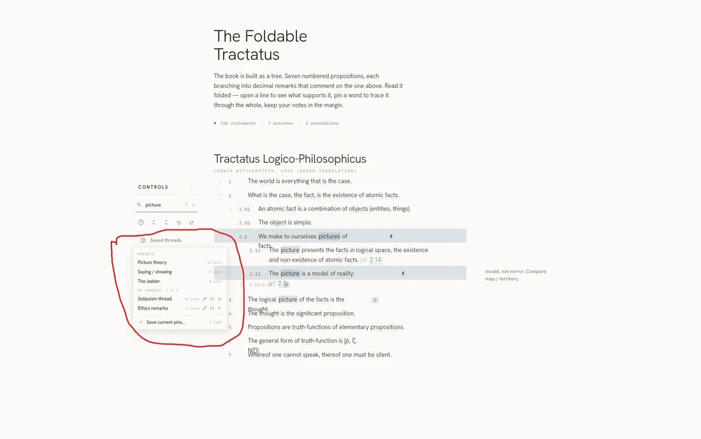

# Session 18: Annotated-sketch edit

Claude Design · Design · 1 prompt · 27 words

[← Session 17](17-search-box.md) · [All sessions](README.md) · [Session 19 →](19-save-icon-swap.md)

## Prompt 75

**Summary:** Ask why UI elements overlap the opened menu and fix it by putting the menu at the highest z-level so it covers everything else.

- **Phase:** Design
- **Human:** 27 words · ~41 s to write · 1 image · 2 files
- **LLM:** Fable 5 · Claude Design · 51 s · +3 −2 lines
- **Outcome:** bug reported, bug fixed, constraint

### Prompt

> Why, when the menu is opened, UI elements of the main text overlap it? The menu should obviously be at the highest z level, covering everything else

### Reply of Claude Design

Fixed. The Controls panel now establishes a stacking context above the text column whenever any of its dropdowns (Saved threads, More, Export) is open, so the menu covers everything beneath it. It stays below modals/toasts.

*The prototype after this reply (screenshot, not included): The prototype "Foldable Tractatus" with the saved threads menu open: the menu lists three presets and two saved threads, and it covers the statements beneath it instead of sitting behind them.*

---

[← Session 17](17-search-box.md) · [All sessions](README.md) · [Session 19 →](19-save-icon-swap.md)
