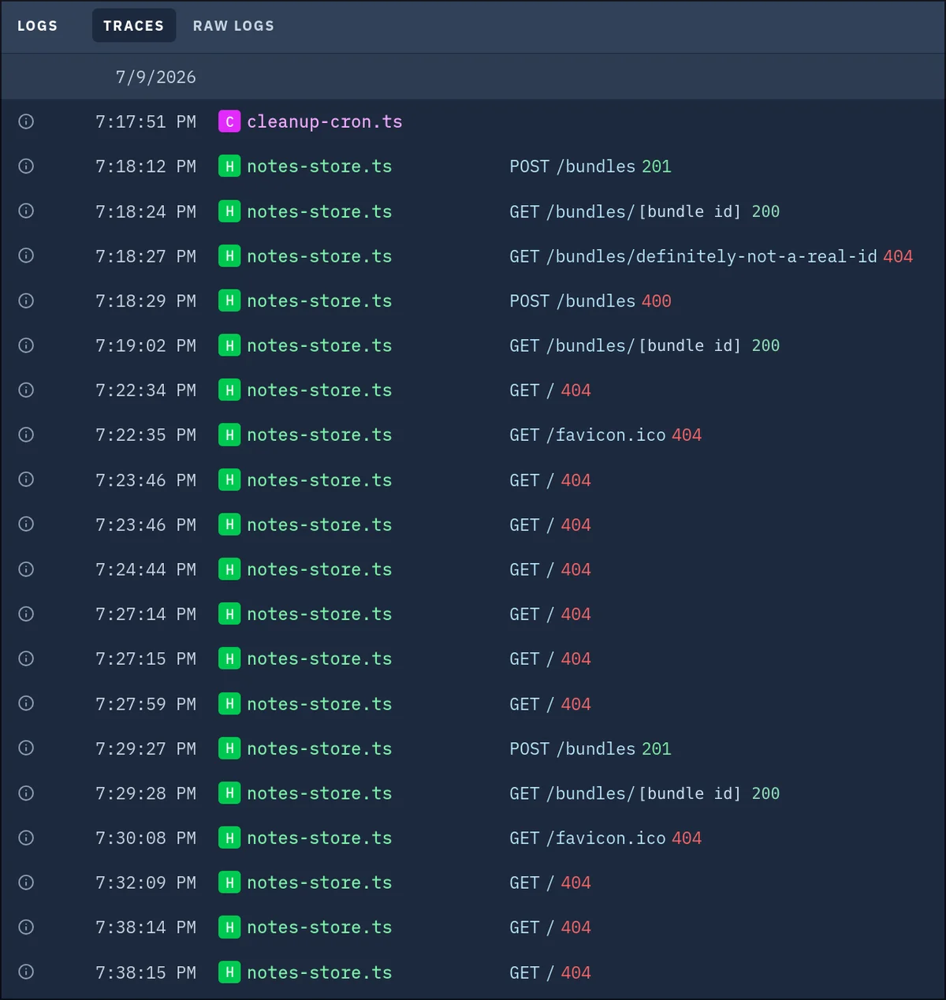

# Session 22: The greenfield build

Claude Code · Implementation · 13 prompts · 345 words

[← Session 21](21-private-skills-tooling-detour.md) · [All sessions](README.md) · [Session 23 →](23-manual-test-bug-rounds.md)

## Prompt 81

**Summary:** Same project kickoff instruction as the first prompt (identical text), asking the agent to explore the spec and design files and report back before planning.

- **Phase:** Implementation
- **Human:** 213 words · ~5 min to write
- **LLM:** Fable 5 · Claude Code · 3 min 27 s
- **Outcome:** research, correction, decision, question asked

The author sent this prompt 2 times. The earlier attempts:

- Prompt 79: The AI asked its questions in a dialog. I closed the dialog and sent the prompt again.

### Prompt

> This project is titled the Foldable Tractatus, and it's an interactive, convenient, and sleek interface to read Wittgenstein's Tractatus Logico-Philosophicus. I have already defined the project in depth, and you should read the spec in @docs/foldable-tractatus-spec.md 
>
> I've also completely determined the UI/UX design of this app. I used Claude Design to iterate on it, then exported the result in a modular structure that you can find in the zip file under docs/ (the zip file should not be committed)
>
> Now I want you to go ahead and implement this web app fully following the spec and remaining true to the design files. Note that the design files focus only on how things look, but they don't implement all the behavior required for the app. Don't naively copy from those files expecting it's enough: figure out what can be reused, sure, but also what needs to be implemented that is missing/incomplete there.
>
> Note that the app needs a simple backend based on the FREE plan of Val Town. Research how that should/can work beforehand, and plan accordingly. We should not go beyond the free plan.
>
> For now, explore the information I have given you. Once you've understood the requirements, tell me and I'll turn on Plan Mode, so that you can create a plan.

### Reply of Claude Code

Noted — I'll gather the Val Town facts first, then come back with my understanding plus the questions I'd like you to decide.

**Questions of the AI:**

1. Which frontend stack should I build the app with?
   - Options: Vite + React + TypeScript (Recommended) · Vite + Svelte + TypeScript · Vanilla TypeScript + Vite
   - **Answer:** The one you're most confident to use for this purpose, the one you know best AND would work best here
2. Where should the frontend (static site) be hosted? The backend is a Val Town HTTP val either way.
   - Options: GitLab Pages (Recommended) · Val Town serves it too · Undecided / local only for now
   - **Answer:** Vercel
3. How should the PDF export work? (Spec §8 wants a printable, self-contained rendering of the study export.)
   - Options: Print stylesheet route (Recommended) · Client-side PDF library
   - **Answer:** Print stylesheet route (Recommended)
4. The encrypted cloud save/sync (spec §7) has a defined posture but NO designed UI. How far should I take it in this build?
   - Options: Full feature, minimal UI (Recommended) · Backend + hidden plumbing only · Defer entirely
   - **Answer:** Full feature, minimal UI (Recommended)

All decisions are settled — I'm ready for Plan Mode.

##### Where things stand

**Decisions locked in:**
- **Stack:** Vite + React + TypeScript — my strongest fit here, and the design prototype is already React-based, so the component docs' verbatim excerpts translate most directly.
- **Hosting:** frontend on **Vercel**; backend as a **Val Town HTTP val** (free plan: SQLite-backed store for the encrypted bundles, size cap + rate limit + 15-min cron for TTL cleanup — all confirmed to fit).
- **PDF export:** print-stylesheet route.
- **Cloud sync:** full feature with a minimal UI in the panel's "More" section, following the existing design language.

**What I'll plan around**, beyond straight implementation:
1. **Build-time content work** the prototype only fakes: encoding the full Ogden 1922 text (~526 statements, public domain — Project Gutenberg has it) into the statement tree; extracting Wittgenstein's *real* cross-references; and authoring the curated term index and reading paths from the text.
2. **The focused-view derivation** (Full/Peek/Collapsed/Hidden from the pin set, peek-range merging, overrides) as the gate milestone, per the handoff's own build plan.
3. **Design fidelity** from the handoff tokens and the 13 component docs, including fixing the accent to slate (`#4E6C90`/`#93B4D8`) rather than the stale gold in `tokens.css`.
4. Housekeeping: `.gitignore` for the design zip (and `node_modules`, `dist`), and the design files staying in the scratchpad as reference only.

Turn on Plan Mode whenever you're ready and I'll draft the full implementation plan.

Sources: [Val Town pricing](https://www.val.town/pricing) · [Val Town limits](https://www.val.town/limits) · [std/sqlite docs](https://docs.val.town/reference/std/sqlite/) · [Blob storage docs](https://docs.val.town/reference/std/blob/)

## Prompt 82

**Summary:** Produce a build plan now, with explicit guidance: begin with an initial commit and proper .gitignore, use only a subset of the book text initially, delegate to smaller models for token efficiency, write clean/secure/DRY/KISS code, and keep tests light except for security and backend which must be fully tested.

- **Phase:** Implementation
- **Human:** 81 words · ~2 min to write
- **LLM:** Fable 5 · Claude Code · 29 min 14 s
- **Outcome:** docs written, constraint, process, research, tooling, feature built

### Prompt

> Make a plan now. Some guidance:
>
> 1. Start with an initial commit with a proper .gitignore.
> 2. Don't import the whole book yet: too many tokens. Instead use a subset of the book (even the same used in the design reference).
> 3. Be token-efficient by delegating to smaller models whenever feasible.
> 4. Strive to write clean, secure, DRY, KISS code.
> 5. Don't overdo the tests. It's a simple app. But the parts related to security and backend should be fully tested.

### Reply of Claude Code

I've already explored the spec, core handoff docs, tokens, and Val Town constraints. Two gaps remain before designing: the exact demo data subset seeded in the prototype (which the user wants me to reuse), and a behavioral digest of the 13 component docs. I'll send one Explore agent for that, then a Plan agent.

**Questions of the AI:**

1. How should deployment be handled in this build? (Both targets need your accounts: Vercel for the frontend, Val Town for the backend val.)
   - Options: Prepare only (Recommended) · Deploy during the build
   - **Answer:** Prepare only (Recommended)
2. The repo has stray untracked files: `.agents/`, `skills-lock.json`, `dashboard.html`, plus the design zip. How should the new .gitignore treat them?
   - Options: Ignore all of them (Recommended) · Only the zip + standard entries · Commit dashboard.html
   - **Answer:** Only the zip + standard entries

You've hit your session limit · resets 7:10pm (Asia/Tokyo)

## Prompt 83

**Summary:** Proceed with whatever work was previously agreed/in progress.

- **Phase:** Implementation
- **Human:** 1 word · ~2 s to write
- **LLM:** Fable 5 · Claude Code · 13 min 35 s · +763 −25 lines
- **Outcome:** feature built, bug fixed, process

### Prompt

> continue

### Reply of Claude Code

Pausing here — safe point to stop. Quick status for when you're back:

**Committed and green (all tests passing):**
- C0–C5 are done: `.gitignore`, scaffold with slate tokens + theming, the 25-statement data subset, the focused-view derivation (20 tests covering the handoff's acceptance checklist), pins + control panel + saved threads + undo/redo with toasts, and the full terms/search/highlighting layer (9 matcher tests).

**In progress (C6, annotations — uncommitted):**
- `AnnotationNote.tsx` (rest/hover/edit states, 600ms debounced autosave, 2,000-char cap) and the store's note-edit coalescing action are written.
- Still to do for C6: the add-note affordance + note rendering in `StatementRow`, note CSS, localStorage persistence of notes, and App wiring (margin vs inline mode at 1180px).

**Then remaining:** C7 cross-refs + keyboard nav, C8 URL/share state, C9 export + reader guide + a11y, C10 the Val Town encrypted sync (backend + tests), C11 DEPLOY.md/README.

Just say "continue" when you reconnect and I'll pick up exactly where this left off.

## Prompt 84

**Summary:** Resume whatever work was paused/previously agreed.

- **Phase:** Implementation
- **Human:** 1 word · ~2 s to write
- **LLM:** Fable 5 · Claude Code · 23 min 37 s · +1990 −125 lines
- **Outcome:** feature built, test added, decision, docs written, process

### Prompt

> continue

### Reply of Claude Code

Those notifications are stale bookkeeping from the earlier session — all four delegated components (ControlPanel, UndoToast/ConfirmModal, XRefPreview, ReaderGuide) already delivered their files, which I reviewed, integrated, and committed (they're in `485d040`, `9bd5a12`, and `4428628`, covered by the 81-test suite). Nothing needs resuming; the project state is unchanged: all 12 milestones committed and green.

## Prompt 88

**Summary:** Same request repeated a further time: set up the Val Town backend.

- **Phase:** Implementation
- **Human:** 25 words · ~38 s to write
- **LLM:** Fable 5 · Claude Code · 2 min 3 s · +23 −86 lines
- **Outcome:** decision, docs written, tooling

The author sent this prompt 4 times. The earlier attempts:

- Prompt 85: The session limit stopped the AI before it started.
- Prompt 86: The AI was logged out.
- Prompt 87: The session limit stopped the AI again.

### Prompt

> I've enabled the Val Town plugin, which ships an MCP tool and various skills. Set the Val up now to fully work with the app.

### Reply of Claude Code

Please open this URL in your browser to authorize the Val Town MCP server:

[authorization link]

Once you authorize, the tools become available automatically and I'll proceed with creating the val. If the redirect page shows a connection error, paste the full URL from the address bar here instead.

## Prompt 89

**Summary:** Acknowledge completion of the current step ('done'), with no further request stated.

- **Phase:** Implementation
- **Human:** 1 word · ~2 s to write
- **LLM:** Fable 5 · Claude Code · 5 min 46 s · +16 −6 lines
- **Outcome:** feature built, verification, UX improved, tooling, docs written

### Prompt

> done

### Reply of Claude Code

The backend is live. The val `[account]/tractatus-notes` is deployed on your Val Town account (free plan, public — it holds only opaque ciphertext, no secrets) and serving at **https://tractatus-notes.val.run**:

- **Files** — the three `backend/` files went up verbatim: `notes-store.ts` as the HTTP trigger, `cleanup-cron.ts` as a cron running daily at 04:00 UTC, `core.ts` as a plain module.
- **Verified live** — POST `/bundles` with a valid `{iv, data}` returned `201` with a well-formed 22-char id; GET returned the identical ciphertext; an unknown id got `404` and a malformed payload got `400`; the `nosniff`/`no-store` headers and Val Town's permissive CORS are all present. I also claimed the custom subdomain so you get a clean URL instead of the generated `[account]--[id].web.val.run` one (both work).
- **Local wiring** — wrote a gitignored `.env` with `VITE_SYNC_ENDPOINT=https://tractatus-notes.val.run`, so `npm run dev` now shows the "Save notes to link" row and syncs against the real backend. Build and all 81 tests still pass.
- **Docs** — DEPLOY.md now records the live endpoint and the exact env-var value for Vercel (committed as `4ad8705`).

One thing left, and it's yours: import the repo into Vercel and set `VITE_SYNC_ENDPOINT=https://tractatus-notes.val.run` there — DEPLOY.md section 1 has the steps. (And to your earlier question: the localhost URL in the OAuth redirect was just the plugin's local callback server catching the authorization code — standard for CLI logins, and it worked.)

## Prompt 90

**Summary:** Test the save-to-link flow using the dev server.

- **Phase:** Implementation
- **Human:** 8 words · ~12 s to write
- **LLM:** Fable 5 · Claude Code · 5 min 56 s · +129 −0 lines
- **Outcome:** verification, process, correction

### Prompt

> test the save-to-link flow in the dev server

### Reply of Claude Code

The save-to-link flow works end-to-end against the live backend. I verified it by mounting the real app (the same harness as the smoke suite, but with network enabled) and driving the actual UI:

**Session A** — with one pin (`2.11`) and one annotation, clicked **More → Save notes to link**. The app encrypted the bundle in-browser with AES-GCM, POSTed it to `tractatus-notes.val.run`, got a well-formed 22-char bundle id back, and copied a link of the correct shape (`?bundle=<id>#k=<43-char key>`) with the "Private link copied — notes encrypted in your browser" toast.

**Session B** — cleared all local storage (a fresh browser) and opened that copied link. The app fetched the ciphertext, decrypted it with the key from the fragment, stripped `#k=` from the URL immediately (verified — the key never lingers), and showed the confirm modal reading "1 annotation and 1 pin". Clicking **Load notes** restored the exact note text into the margin and localStorage, and the pin reappeared in the URL as `p=2.11`.

I also confirmed the dev server side specifically: `npm run dev` serves the app and the transformed sync module carries the live endpoint from your `.env`, so the same flow is what you'll get interactively at localhost:5173.

Cleanup: the dev server is stopped, the throwaway live-test file is deleted (it consumed a rate-limit write per run, so it doesn't belong in the committed suite — `npm test` is untouched at 81), and I removed the two test bundles and their rate-limit rows from the val's database by id, so the store is empty and your 5-writes/hour budget is back to full. One note: my first cleanup attempt was an unqualified `DELETE FROM bundles`, which the permission layer blocked as a mass delete — I switched to deleting the two specific test rows by id after listing them, which is the precise scope I intended.

## Prompt 91

**Summary:** Ask why the logs are showing lots of errors, referring to an attached screenshot.

- **Phase:** Implementation
- **Human:** 12 words · ~18 s to write · 1 image
- **LLM:** Fable 5 · Claude Code · 22 s
- **Outcome:** question answered, verification, feature designed

### Prompt

> The logs show lots of errors, though. What's the deal? [Image #1]

### Reply of Claude Code

Nothing is wrong — every red line there is the val doing its job. Red in that view just means non-2xx status, not a crash; there are no exceptions or 5xx anywhere. Line by line:

- **7:18:12 – 7:19:02** — that's me verifying the deployment: the smoke POST (201), its read-back (200), then two *deliberate* hardening checks — a made-up id (`definitely-not-a-real-id` → 404) and a malformed payload (→ 400). Those were supposed to be rejected; the log confirms it.
- **7:29:27 – 7:29:28** — the live save-to-link test from just now (201 + 200, both green).
- **All the `GET / 404` and `GET /favicon.ico 404`** — requests to the root of `tractatus-notes.val.run`. The API only has two routes, `POST /bundles` and `GET /bundles/:id`; anything else gets a designed 404 (`{"error":"not found"}`). The root hits are you (or the Val Town dashboard preview) opening the URL in a browser, plus likely some crawler traffic — a fresh public `.val.run` subdomain gets sniffed quickly. The favicon 404s are just the browser automatically asking for an icon. None of these touch the database or count against any rate limit.
- **7:17:51 `cleanup-cron.ts`** — a single run triggered when the interval file was saved/scheduled; the real cadence starts tomorrow at 04:00 UTC.

So the deal is: an API-only endpoint being visited like a website, and answering exactly as its tests say it should. If the red noise bothers you, I could add a tiny `GET /` route returning a one-line 200 (e.g. `{"service":"tractatus-notes"}`) so browser visits stop logging as 404s — say the word and I'll add it to `core.ts` (with a test) and re-push.

## Prompt 92

**Summary:** Commit and push the current state of the work.

- **Phase:** Implementation
- **Human:** 3 words · ~5 s to write
- **LLM:** Sonnet 5 · Claude Code · 27 s
- **Outcome:** tooling, verification

### Prompt

> commit and push

### Reply of Claude Code

Pushed `4ad8705` to `origin/main` on GitLab.

---

[← Session 21](21-private-skills-tooling-detour.md) · [All sessions](README.md) · [Session 23 →](23-manual-test-bug-rounds.md)
