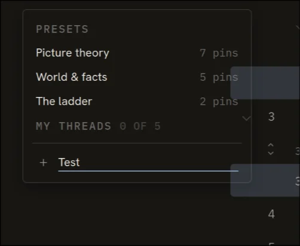
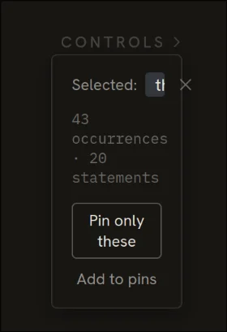

# Session 23: Manual-test bug rounds

Claude Code · Implementation · 25 prompts · 1505 words

[← Session 22](22-the-greenfield-build.md) · [All sessions](README.md) · [Session 24 →](24-sharing-feature-q-a.md)

## Prompt 93

**Summary:** Analyze the codebase and write a CLAUDE.md guidance file for future agents, following detailed content and formatting rules including a required prefix.

- **Phase:** Implementation
- **Human:** 254 words · ~6 min to write
- **LLM:** Opus 4.8 · Claude Code · 2 min 36 s · +109 −0 lines
- **Outcome:** docs written, constraint

### Prompt

> Please analyze this codebase and create a CLAUDE.md file, which will be given to future instances of Claude Code to operate in this repository.
>
> What to add:
> 1. Commands that will be commonly used, such as how to build, lint, and run tests. Include the necessary commands to develop in this codebase, such as how to run a single test.
> 2. High-level code architecture and structure so that future instances can be productive more quickly. Focus on the "big picture" architecture that requires reading multiple files to understand.
>
> Usage notes:
> - If there's already a CLAUDE.md, suggest improvements to it.
> - When you make the initial CLAUDE.md, do not repeat yourself and do not include obvious instructions like "Provide helpful error messages to users", "Write unit tests for all new utilities", "Never include sensitive information (API keys, tokens) in code or commits".
> - Avoid listing every component or file structure that can be easily discovered.
> - Don't include generic development practices.
> - If there are Cursor rules (in .cursor/rules/ or .cursorrules) or Copilot rules (in .github/copilot-instructions.md), make sure to include the important parts.
> - If there is a README.md, make sure to include the important parts.
> - Do not make up information such as "Common Development Tasks", "Tips for Development", "Support and Documentation" unless this is expressly included in other files that you read.
> - Be sure to prefix the file with the following text:
>
> ```
> # CLAUDE.md
>
> This file provides guidance to Claude Code (claude.ai/code) when working with code in this repository.
> ```

### Reply of Claude Code

Created [CLAUDE.md](CLAUDE.md). It captures what isn't obvious from a quick file scan:

- **Commands** — build/test/dev, single-test invocations, and the fact that "lint" is just `tsc --noEmit` (via `npm run build`), with backend tests folded into `npm test`.
- **The derived-view core** — the central idea that display state is *derived* from `(tree, pins, sparse overrides)` and peeks are computed, never stored; plus the `normalizeOverrides` invariant and why override edits must go through the helpers.
- **State separation** — snapshot-based undo/redo, active-term-not-in-history, note coalescing, and the deliberate persistence boundaries (annotations → localStorage never in URLs; view state → compact URL codec; threads → separate local library).
- **Backend design** — platform-agnostic `core.ts` with an injected SQLite client (same code on Val Town and in tests), and the client-encrypts / key-in-fragment / host-sees-only-ciphertext security posture.
- **Data status** — the current curated ~25-statement subset vs. the planned full text, and that `src/data/` is the only thing that changes for it.

Each section points readers at the spec (`docs/foldable-tractatus-spec.md`), which the code references throughout via §N markers.

## Prompt 94

**Summary:** Ask for help fixing a dev-server startup error (rolldown native binding not found) after running npm install.

- **Phase:** Implementation
- **Human:** 188 words · ~5 min to write
- **LLM:** Opus 4.8 · Claude Code · 2 min 15 s
- **Outcome:** bug fixed, verification

### Prompt

> now help me start the dev server. I did "npm i" but I still get an error.
>
> npm run dev
>
> > foldable-tractatus@0.1.0 dev
> > vite
>
> file://~/dev/webapps/foldable-tractatus/node_modules/rolldown/dist/shared/binding-TuFFIE_J.mjs:509
> 			const error = /* @__PURE__ */ new Error("Cannot find native binding. npm has a bug related to optional dependencies (https://github.com/npm/cli/issues/4828). Please try `npm i` again after removing both package-lock.json and node_modules directory.");
> 			                             ^
>
> Error: Cannot find native binding. npm has a bug related to optional dependencies (https://github.com/npm/cli/issues/4828). Please try `npm i` again after removing both package-lock.json and node_modules directory.
>     at file://~/dev/webapps/foldable-tractatus/node_modules/rolldown/dist/shared/binding-TuFFIE_J.mjs:509:34
>     at file://~/dev/webapps/foldable-tractatus/node_modules/rolldown/dist/shared/binding-TuFFIE_J.mjs:9:49
>     at file://~/dev/webapps/foldable-tractatus/node_modules/rolldown/dist/shared/parse-D4dtlfWy.mjs:3:46
>     at ModuleJob.run (node:internal/modules/esm/module_job:268:25)
>     at async onImport.tracePromise.__proto__ (node:internal/modules/esm/loader:543:26) {
>   cause: Error: Cannot find module '@rolldown/binding-linux-x64-gnu'
>   Require stack:
>   - ~/dev/webapps/foldable-tractatus/node_modules/rolldown/dist/shared/binding-TuFFIE_J.mjs
>       at Function._resolveFilename (node:internal/modules/cjs/loader:1249:15)
>       ... 4 lines matching cause stack trace ...
>       at require (node:internal/modules/helpers:141:16)
>       at requireNative (file://~/dev/webapps/foldable-tractatus/node_modules/rolldown/dist/shared/binding-TuFFIE_J.mjs:277:21)
>       at file://~/dev/webapps/foldable-tractatus/node_modules/rolldown/dist/shared/binding-TuFFIE_J.mjs:475:18
>       at file://~/dev/webapps/foldable-tractatus/node_modules/rolldown/dist/shared/binding-TuFFIE_J.mjs:9:49
>       at file://~/dev/webapps/foldable-tractatus/node_modules/rolldown/dist/shared/parse-D4dtlfWy.mjs:3:46 {
>     code: 'MODULE_NOT_FOUND',
>     requireStack: [
>       '~/dev/webapps/foldable-tractatus/node_modules/rolldown/dist/shared/binding-TuFFIE_J.mjs'
>     ],
>     cause: Error: Cannot find module '../rolldown-binding.linux-x64-gnu.node'
>     Require stack:
>     - ~/dev/webapps/foldable-tractatus/node_modules/rolldown/dist/shared/binding-TuFFIE_J.mjs
>         at Function._resolveFilename (node:internal/modules/cjs/loader:1249:15)
>         at Function._load (node:internal/modules/cjs/loader:1075:27)
>         at TracingChannel.traceSync (node:diagnostics_channel:315:14)
>         at wrapModuleLoad (node:internal/modules/cjs/loader:218:24)
>         at Module.require (node:internal/modules/cjs/loader:1340:12)
>         at require (node:internal/modules/helpers:141:16)
>         at requireNative (file://~/dev/webapps/foldable-tractatus/node_modules/rolldown/dist/shared/binding-TuFFIE_J.mjs:272:12)
>         at file://~/dev/webapps/foldable-tractatus/node_modules/rolldown/dist/shared/binding-TuFFIE_J.mjs:475:18
>         at file://~/dev/webapps/foldable-tractatus/node_modules/rolldown/dist/shared/binding-TuFFIE_J.mjs:9:49
>         at file://~/dev/webapps/foldable-tractatus/node_modules/rolldown/dist/shared/parse-D4dtlfWy.mjs:3:46 {
>       code: 'MODULE_NOT_FOUND',
>       requireStack: [
>         '~/dev/webapps/foldable-tractatus/node_modules/rolldown/dist/shared/binding-TuFFIE_J.mjs'
>       ]
>     }
>   }
> }
>
> Node.js v22.11.0

### Reply of Claude Code

The dev server is up and serving. **http://localhost:5173/** returns 200.

##### What was wrong

The rolldown native binary (`@rolldown/binding-linux-x64-gnu`) was never installed, so Vite 8 couldn't start. It wasn't the ordinary npm lockfile bug the error message blames — a clean reinstall didn't fix it. The real cause:

- That binding package declares `engines: node ^20.19.0 || >=22.12.0`.
- Your Node was **v22.11.0** — one patch line below the `22.12.0` floor.
- npm **silently omits optional dependencies** whose engine check fails, so every `npm i` left the binary out (platform/libc all matched fine).

##### What I did

1. `nvm install 22` → **Node v22.23.1** (additive; your old version is still installed).
2. Reinstalled deps under it — `binding-linux-x64-gnu` now present.
3. Started `npm run dev` — running in the background (task `bk8o27sg2`).

##### To keep it working

New shells will default back to v22.11.0 unless you switch. Two options:

- **Per-project pin** — add an `.nvmrc` so `nvm use` picks the right version automatically here:
  ```sh
  echo "22" > .nvmrc
  ```
- **Make it your default** — `nvm alias default 22`.

Note the dev server is running under the nvm Node; if you restart it from a fresh terminal, run `nvm use 22` first (or set one of the above). Want me to add the `.nvmrc`?

## Prompt 95

**Summary:** Requests implementation of a "per-project pin" feature.

- **Phase:** Implementation
- **Human:** 4 words · ~6 s to write
- **LLM:** Opus 4.8 · Claude Code · 22 s · +1 −0 lines
- **Outcome:** decision, tooling

### Prompt

> do the per-project pin

### Reply of Claude Code

Done. Created [.nvmrc](.nvmrc) pinned to `22`, and confirmed `nvm use` reads it — `Found .../.nvmrc with version <22>`.

Now in this project directory, running `nvm use` (with no argument) selects a Node ≥22.12 automatically. The dev server is still running from earlier at http://localhost:5173/.

Two small notes:
- nvm doesn't auto-switch on `cd` unless you have the shell hook set up; a bare `nvm use` in the project dir does it. If you want fully automatic switching, I can add the nvm `cd` hook to your `~/.zshrc` — say the word.
- The `22` root matches the rolldown binding's `>=22.12.0` requirement since nvm resolves it to the latest installed 22.x (v22.23.1). If you'd rather have others get an explicit npm warning on the wrong Node, I can also add an `engines` field to `package.json`.

## Prompt 96

**Summary:** Instruct the assistant to commit the current changes.

- **Phase:** Implementation
- **Human:** 1 word · ~2 s to write
- **LLM:** Sonnet 5 · Claude Code · 21 s
- **Outcome:** tooling

### Prompt

> commit

### Reply of Claude Code

Committed as `03726b8`: `.nvmrc`, `CLAUDE.md`, and the lockfile update, with a note explaining why the Node pin matters. Not pushed — let me know if you want that too.

## Prompt 97

**Summary:** Report seven distinct bugs/UX problems found in testing (sidebar layout shift, blank PDF export, dropdown z-index, missing confirmation toasts, unclear share affordance, missing overwrite confirmation, and a question about Val Town share behavior) and ask them to be fixed.

- **Phase:** Implementation
- **Human:** 264 words · ~7 min to write · 1 image
- **LLM:** Fable 5 · Claude Code · 17 min 29 s · +572 −140 lines
- **Outcome:** bug fixed, UX improved, feature built, docs written, question asked

### Prompt

> A quick test revealed these problems you should fix now:
>
> 1. The main section containing the statements should be fixed horizontally. Instead, when I collapse and expand the left sidebar (which changes in width in the process), the whole section gets shifted left and right. It should be the other way around: fixed horizontal position of the main body, and the sidebar flushed against it.
> 2. The markdown export works, but the PDF (print preview) comes out completely blank.
> 3. As shown in the image, the dropdown fails to cover some other UI elements. It should be at the top of the z ladder. This issue was already fixed in the design files. 
> 4. Saving a new named thread, renaming it, overwriting it, or deleting it should all trigger confirmation toasts.
> 5. Saving a new named thread closes the dropdown, but there is no indication that this can be shared with others, or how.
> 6. When activating a thread (either preset or saved), a confirmation dialog must be shown, because it would overwrite existing pins. This is present in the reference design files, and you already implemented it for the "Pin only these" action when a word is selected. If the spec fails to mention that the same modal is necessary at thread selection, update the spec.
> 7. I used the "Share" function with some pins but no notes, and it worked in another browser: I could see the same pins. However, nothing was created on Val Town. Is this the correct behavior?
>
>
> I have some more, but for now focus on resolving these.



### Reply of Claude Code

You've hit your session limit · resets 12:10am (Asia/Tokyo)

*The app before this prompt (screenshot, not included): The first build of the app, before the fixes of this prompt: all statements are open, with one pin and one note. The left sidebar has the search box and the Saved threads menu.*

## Prompt 98

**Summary:** Asks the assistant to proceed with the previously agreed work (the bug-fix list).

- **Phase:** Implementation
- **Human:** 1 word · ~2 s to write
- **LLM:** Fable 5 · Claude Code · 4 min 28 s · +340 −2 lines
- **Outcome:** test added, verification

### Prompt

> continue

### Reply of Claude Code

All six fixes are done and verified — 85 vitest tests pass (including 4 new ones), `tsc --noEmit` + build are clean, and I confirmed every fix in a real headless browser against the dev server (reading column pixel-identical before/after collapsing the sidebar, print view rendering under print media, dropdown painting over content, modal and toasts firing).

What changed, per issue:

1. **Layout shift** — the app shell centered all three columns, so the sidebar's 108↔176px animation re-centered the row. [global.css](src/styles/global.css) now gives `.panel-col` a constant 176px track and right-aligns the panel inside it, so collapsing moves only the panel's left edge; the reading column never moves and the panel stays flush against it.
2. **Blank PDF** — `<PrintView>` was rendered *inside* `.app-root`, which print CSS hides wholesale (`display:none` on an ancestor can't be undone by a descendant). It and the other overlays (toast, guide, modal) now render as siblings of `.app-root` in [App.tsx](src/App.tsx), and the print hide-list also covers the guide scrim. Print preview now shows the study export.
3. **Dropdown z-index** — the panel's `z-index: 40` was trapped inside the stacking context created by the sticky wrapper, so the cross-ref popover (z-30) and statement rows painted over it. [panel.css](src/styles/panel.css) now lifts the wrapper itself (`.panel-sticky:has(.cp-panel.is-elevated) { z-index: 40 }`). One caveat: the "design files" you mentioned aren't in the repo — code comments reference `design/handoff/...` paths that don't exist here — so I implemented the fix directly rather than copying it.
4. **Thread toasts** — save, rename, overwrite, and delete each now raise a toast with the thread's name (non-undoable, since threads live outside the undo history).
5. **Share indication** — the save toast reads `Thread "X" saved — Share (under More) copies a link to this view`, and the menu has a permanent hint line: *"Threads stay in this browser. To send the current view to someone, use Share under More."* The copy is deliberate: threads themselves are local-only; what's shareable is the pinned view.
6. **Confirmation on activation** — applying a preset or saved thread over existing pins now opens the same `ConfirmModal` as "Pin only these" (with no pins set, it applies immediately — nothing to overwrite). Internally the three confirm flows were consolidated into one `PendingConfirm` union. The spec didn't mention this, so §11 and §12 were updated to require it.

**Issue 7 — yes, that's correct behavior.** Share never contacts the backend: pins are view state and travel entirely in the URL (`?p=…`), which is why the link worked in another browser. Val Town is only written by the separate opt-in "Save notes to link" action, which encrypts your notes client-side first (spec §7). Nothing was wrong — and the new hint from issue 5 should make the distinction visible in the UI.

Ready for your next batch whenever you are.

## Prompt 99

**Summary:** Request several new refinements (pin count display, prominent unpin-all with confirmation, thread-deletion confirmation, button wording change, enter-to-save note editing, lower character cap, and a fix for overlapping margin notes) and ask for ideas/visual sketches for the overlap problem.

- **Phase:** Implementation
- **Human:** 272 words · ~7 min to write
- **LLM:** Fable 5 · Claude Code · 93 min 7 s · +916 −0 lines
- **Outcome:** feature designed, UX improved, feature built, constraint

### Prompt

> 1. New req to also add to the spec: I want the number of pins (when >1) to be shown alongside the number of statements and  branches in the information line.
> 2. Also new: we need a prominent "unpin all" (with confirmation modal) somewhere. Where would be a good place/UX?
> 3. Also new: thread deletion should ask for confirmation.
> 4. In the "Replace your current pins?" confirmation popup, the button should say "Yes", not "Apply reading path"
> 5. In the note UI, pressing enter should confirm and exit editing instead of adding a newline. The user can use shift+enter to enter newlines instead.
> 6. Let's lower the max characters in a note to 1000 instead of 2000. Update the spec accordingly.
> 7. Big bug: long notes or notes that are too close to each other (which happens often due to folding) will overlap each other and become unreadable. We need to figure out a good UI to handle this case. Any ideas? I checked how Readwise Reader does this, and they just let the notes of different highlights overlap each other, with background fill behind the text so that at least the note with the highest z value is readable. Clicking on one of those highlights will bring its annotation to the highest z, so that it is readable (covering the others). I still find it clunky that they overlap like that, though. Maybe in such cases the annotations can be truncated just enough to avoid overlap, and clicking on them expands them and makes them cover the others temporarily? I'd like to see visual sketches of how possible solution could work.

### Reply of Claude Code

While the screenshot check runs, one quick look at the modal component for the button-label change:

**Questions of the AI:**

1. Which treatment for overlapping margin notes? (See the live sketches: [private link])
   - Options: D — clamp + push (Recommended) · C — push-down only · B — clamp + cover · A — overlap + raise
   - **Answer:** D — clamp + push (Recommended)
2. Where should the prominent "Unpin all" live?
   - Options: Toolbar button (Recommended) · Info-line chip · Both
   - **Answer:** In the Toolbar, but since now we have 6 buttons, instead of crowding them in one row put them in two rows.

All seven items are done and verified: 95/95 tests pass (10 new), the strict build is clean, and an 18-check headless browser run confirmed every flow with screenshots.

**The overlap fix (item 7)** — implemented your chosen option D from the [sketches]([private link]). Margin notes now rest clamped to 3 lines (a small `⌄ more` appears only when text is actually cut), and a layout pass ([noteLayout.ts](src/lib/noteLayout.ts), pure and unit-tested) slides notes down just enough that no two ever overlap. Clicking a note opens the editor, which doubles as the expanded state: it's pinned to its statement while neighbours ease out of the way. A note resting away from its statement shows a small mono number label, and hovering a row highlights its note (and vice versa). Verified in a real browser: three crowded notes had zero overlapping rectangles at rest *and* while the long one was expanded (it grew ~120px and its neighbour moved exactly below it).

The rest:

1. **Pin count in the info line** — shows `N pins` between branches and annotations, only when more than one is pinned (per your ">1"). Spec §4 updated.
2. **Unpin all** — new toolbar button (`clear_all` icon), and the toolbar is now a 3-column grid so the six tools read as two rows of three. It confirms first ("Remove all pins?"), is greyed out with no pins, and is a single undoable step. One deliberate choice: unlike applying a thread, it keeps your manually opened branches — only the pins go (spec §4/§12 record this).
3. **Thread deletion confirms** — "Delete this thread?" with the thread's name and pin count; the body notes it can't be undone, since threads live outside undo history (spec §11).
4. **Button says "Yes"** — in both dialogs titled "Replace your current pins?" (thread/preset activation and "Pin only these"). The bundle-import dialog keeps "Load notes" since it's a different question.
5. **Enter commits notes** — Enter saves and closes the editor; Shift+Enter inserts a newline (spec §6).
6. **Note cap is 1,000** — one constant change that also flows to localStorage loading and sync sanitizing; spec §6 updated and open question 2 in §14 marked resolved. Heads-up: any existing local note over 1,000 chars gets truncated the next time it loads.

Changes are uncommitted, same as the previous batch — say the word and I'll commit both. Ready for the next round of findings.

## Prompt 100

**Summary:** Commit current changes, then fix the pin-count label so it also shows "1 pin" and uses the accent color like the annotations counter.

- **Phase:** Implementation
- **Human:** 43 words · ~1 min to write
- **LLM:** Fable 5 · Claude Code · 1 min 46 s · +26 −18 lines
- **Outcome:** tooling, bug fixed, UX improved, docs written

### Prompt

> Commit, then tackle these smaller improvements:
> - The "# pins" label is shown only when I add a second pin. "1 pin" is never shown.
> - The "# pins" label should use the accent color, like the "# annotations" label next to it.

### Reply of Claude Code

Done. Committed both QA batches as `05c0980`, then made the two tweaks:

- The info line now shows the count from the first pin — `1 pin`, `2 pins`, and so on ([ReadingColumn.tsx:69-76](src/components/ReadingColumn.tsx#L69-L76)).
- It renders in the accent color via the same class as the annotation count. Since that class was named `rc-meta-notes`, I renamed it to `rc-meta-accent` and pointed both labels at it — one rule, honestly named ("the reader's own contributions read in the accent").

The smoke test now asserts both the singular form and the plural, and the spec §4 sentence was reworded to match (any pins, accent treatment). 95/95 tests and the strict build pass. These two tweaks are uncommitted — I'll fold them into the next commit or commit them now if you want.

*The app after this change (screenshot, not included): The app: the info line under the introduction reads "25 statements / 7 branches / 1 pin", with "1 pin" in the accent color. Statement 1.11 is pinned and highlighted.*

## Prompt 101

**Summary:** Instruct the assistant to commit the current changes.

- **Phase:** Implementation
- **Human:** 1 word · ~2 s to write
- **LLM:** Fable 5 · Claude Code · 16 s
- **Outcome:** tooling

### Prompt

> commit

### Reply of Claude Code

Committed as `03726b8`: `.nvmrc`, `CLAUDE.md`, and the lockfile update, with a note explaining why the Node pin matters. Not pushed — let me know if you want that too.

## Prompt 102

**Summary:** Report that the "share link" button incorrectly alters local pin state, and specify it should only copy the link/show a toast without changing pins.

- **Phase:** Implementation
- **Human:** 74 words · ~2 min to write
- **LLM:** Fable 5 · Claude Code · 3 min 0 s · +56 −38 lines
- **Outcome:** bug fixed, refactor, docs written, test added

### Prompt

> Now the "share link" functionality behaves differently from what it should. Clicking on the sharing icon next to a statement, it clears all other pins and pins only the one you clicked. This is disruptive! Instead, It should just copy the link (with a notification toast) and not alter the pin state on the current browser at all. It's meant just to allow sharing single statements to others, not to modify the local state.

### Reply of Claude Code

Fixed — the per-statement share button now only copies the link; your local view is untouched.

What changed:

- [App.tsx:182-190](src/App.tsx#L182-L190) — `shareStatement` builds the `?statement=N` deep link, copies it, and shows a plain toast (`Link to statement N copied`, or a copy-failure message). It no longer dispatches anything that touches pins, overrides, or undo history.
- [store.tsx](src/state/store.tsx) — removed the now-dead `isolate` reducer action entirely; the recipient side of `?statement=N` was never handled through it (the store isolates at init from the URL), so nothing else depended on it.
- [StatementRow.tsx:107](src/components/StatementRow.tsx#L107) — the button's aria-label dropped "and pin only it".
- Spec — §4 retitled "Pinning and sharing a statement": the share control copies the deep link, never alters the sharer's own view, and only the *recipient* gets the isolated view; §12's deep-link bullet updated to match, and "isolate" removed from the undo-history lists (it's no longer a local action).
- [App.smoke.test.tsx](src/App.smoke.test.tsx#L213-L231) — new test: with statement 1 pinned, sharing statement 2 copies a link containing `?statement=2` (clipboard stubbed), shows the toast, and leaves the URL at `?p=1` with statement 2 unpinned.

96/96 tests pass and the strict build is clean. Ready to commit whenever you say.

## Prompt 103

**Summary:** Instruct the assistant to commit the current changes.

- **Phase:** Implementation
- **Human:** 1 word · ~2 s to write
- **LLM:** Fable 5 · Claude Code · 18 s
- **Outcome:** tooling

### Prompt

> commit

### Reply of Claude Code

Committed as `e5b3ae3` — 5 files changed (App, store, StatementRow, spec, smoke test), working tree clean.

## Prompt 104

**Summary:** Report that the first annotation is missing its annotation number label, unlike all others, and ask for it to be fixed.

- **Phase:** Implementation
- **Human:** 16 words · ~24 s to write
- **LLM:** Fable 5 · Claude Code · 2 min 53 s · +76 −26 lines
- **Outcome:** bug fixed, docs written, verification

### Prompt

> All annotations have the annotation number shown right above, except for the first one. Fix that.

### Reply of Claude Code

Fixed — every margin note now shows its statement number, including the first one.

The label was gated on an `is-displaced` class that the layout pass only added to notes pushed away from their own row; the first note in a stack always sits at its anchor, so it alone went unlabelled. The number is now unconditional for margin notes:

- [reading.css](src/styles/reading.css#L334-L343) — `.note-num` is `display: block` outright; the `is-displaced` rule is gone.
- [ReadingColumn.tsx](src/components/ReadingColumn.tsx) — the layout pass no longer computes or toggles `is-displaced` (it existed only for this label).
- [AnnotationNote.tsx](src/components/AnnotationNote.tsx#L116-L119) and spec §6 updated: every margin note is labelled with its statement's number.

Verified: 96/96 tests and the strict build pass, and a headless screenshot shows both a first (undisplaced) note and its crowded neighbour wearing their numbers (`2`, `2.1`). Ready to commit when you say.

*The app after this change (screenshot, not included): The app: two margin notes sit at the right, "all the facts" beside 1.1 and "what is not the case, too" beside 1.12. A small statement number sits above each note, the first included.*

## Prompt 105

**Summary:** Improve search-box keyboard behavior: pressing Enter or Esc while focused should unfocus the box without clearing its text, so keyboard navigation can resume.

- **Phase:** Implementation
- **Human:** 36 words · ~54 s to write
- **LLM:** Fable 5 · Claude Code · 2 min 39 s · +48 −6 lines
- **Outcome:** UX improved, docs written, test added

### Prompt

> Improve the keyboard behavior too:
> - When pressing Enter or Esc while the search box is focused, unfocus the search (without clearing it) so that the user can resume using the keyboard to navigate the text.

### Reply of Claude Code

Done — Enter or Esc in the search box now just drops focus, keeping the query intact so arrow/j/k navigation works again immediately.

- [ControlPanel.tsx:177-183](src/components/ControlPanel.tsx#L177-L183) — an `onKeyDown` on the search input blurs it on Enter/Escape (with `preventDefault`), touching nothing else. The global keyboard handler already ignores keys originating from focused inputs, so this doesn't double-fire the app-level Escape (which clears the active term) — the query and any active term survive.
- [ReaderGuide.tsx](src/components/ReaderGuide.tsx#L65) — the `/` shortcut row now reads "Search the text (Enter/Esc leaves the box)". While there I also removed a stale "isolate" from the Undo description, left over from the share-button change.
- Spec §12 — the keyboard-navigation bullet documents the new behavior.
- [App.smoke.test.tsx](src/App.smoke.test.tsx) — new test: focus search, type "picture", Enter unfocuses without clearing; same for Escape.

97/97 tests and the strict build pass. Ready to commit when you say.

## Prompt 106

**Summary:** Correct the prior search-box fix to add visual feedback (inactive styling, focus moves to first statement) and add a new requirement that the "/" shortcut should expand a collapsed panel and focus the search box.

- **Phase:** Implementation
- **Human:** 87 words · ~2 min to write
- **LLM:** Fable 5 · Claude Code · 8 min 25 s · +278 −50 lines
- **Outcome:** UX improved, feature built, bug fixed, verification

### Prompt

> Yes, but when I press Esc or Enter there is no VISUAL feedback. Do this instead: on Esc/Enter, change the searchbox UI state to inactive (no colored underline, no x icon) without clearing the string inside it, then focus the first statement, so that the user understands they can press the up/down arrow keys to navigate again.
>
> Another thing: the `/` shortcut should focus the search box even when the control panel is collapsed. In that case, immediately expand the panel and normally focus the text box.

### Reply of Claude Code

Both behaviors are in, verified in a real browser (10/10 headless checks) and in the test suite (98/98, strict build clean).

**Visible dismissal + focus handoff.** The search line now has a "dismissed" state ([ControlPanel.tsx](src/components/ControlPanel.tsx)): Enter/Esc drops it to its resting look — grey underline, no × button, no count, the `/` hint returns — while the query text and the active term's highlights in the text stay. Editing or refocusing the box re-engages it (any query change also resets the state, so clicking an inline term still lights the box up). On dismissal the panel calls a new `onSearchLeave` callback, which App uses to focus the first statement row — so the focus ring lands visibly in the text and ArrowDown/j immediately moves to the second statement (verified headlessly).

**`/` with a collapsed panel.** The panel's `open` state moved up into App (it was already mirrored there as `panelOpen`), so the `/` handler now opens the panel and focuses the input via a small pending-focus effect that runs after the panel has rendered — focusing an input inside a `display: none` body was the failure mode ([App.tsx:50-57](src/App.tsx#L50-L57)).

Also updated: the reader guide's `/` row now says "(Enter/Esc leaves the box)", spec §12 documents both behaviors, and the two smoke tests cover the dismissed look, kept query, first-row focus, and the collapse-then-`/` flow.

Ready to commit when you say.

## Prompt 107

**Summary:** Instruct the assistant to commit the current changes.

- **Phase:** Implementation
- **Human:** 1 word · ~2 s to write
- **LLM:** Fable 5 · Claude Code · 18 s
- **Outcome:** tooling

### Prompt

> commit

### Reply of Claude Code

Committed as `27d0017` — 8 files (both the search keyboard changes and the note-number fix), working tree clean.

## Prompt 108

**Summary:** Fix UI spacing around the selected-word rectangle and its width/overflow problem when the control panel is collapsed, per an attached screenshot.

- **Phase:** Implementation
- **Human:** 49 words · ~1 min to write · 1 image
- **LLM:** Fable 5 · Claude Code · 3 min 31 s · +88 −18 lines
- **Outcome:** bug fixed, UX improved

### Prompt

> The rectangle showing the selected word needs UI work.
>
> 1. Add a bit more space between it and the control panel.
> 2. When the control panel is collapsed, that rectangle looks wrong (see image). The highlighted word is truncated, and the x icon overflows. Let's fix the width instead.



### Reply of Claude Code

Both fixed — screenshot above shows the collapsed-panel case now: full-width card with clear space under "CONTROLS", the chip intact, and the × sitting inside the card.

Three changes in [panel.css](src/styles/panel.css#L688-L700):

1. **Gap**: `.term-card` gets `margin-top: 14px`, so it no longer butts against the panel.
2. **Width**: the card is always 176px — the `is-narrow` rule (which shrank it to the collapsed panel's 108px and caused the mess in your screenshot) is gone. Since the sticky column right-aligns its children, the wider card just extends left; its right edge stays flush with the reading column. The `narrow` prop was removed from [TermCard.tsx](src/components/TermCard.tsx) and its App call site.
3. **Overflow root cause**: `.term-chip` gets `min-width: 0` — as a flex item it previously refused to shrink below its text, which is what pushed the × out of the card; now genuinely long terms ellipsize inside the chip instead.

Headless check confirms: card width 176, 14px gap above, close button inside the card, chip not truncated for a normal term. 98/98 tests and the strict build pass. Ready to commit when you say.

*The app after this change (screenshot, not included): The app: the word "picture" is selected while the control panel is collapsed. A small card below the "Controls" heading shows the word chip, the occurrence count, and "Pin only these" and "Add to pins" buttons.*

## Prompt 109

**Summary:** Instruct the assistant to commit the current changes.

- **Phase:** Implementation
- **Human:** 1 word · ~2 s to write
- **LLM:** Fable 5 · Claude Code · 14 s
- **Outcome:** tooling

### Prompt

> commit

### Reply of Claude Code

Committed as `de32bec` — 3 files (panel.css, TermCard, App), working tree clean.

## Prompt 110

**Summary:** Request a trashbin delete control (with confirmation) on annotations and LaTeX rendering for mathematical expressions, and ask for a plan before implementing.

- **Phase:** Implementation
- **Human:** 43 words · ~1 min to write
- **LLM:** Fable 5 · Claude Code · 11 min 58 s
- **Outcome:** decision, feature designed, question asked

### Prompt

> Now these changes:
> 1. Add a trashbin icon at the bottom of the annotation component, which the user can click to delete the annotation (with confirmation message)
> 2. Mathematical symbols and expressions should use Latex and proper rendering.
>
> Make a plan for this

### Reply of Claude Code

I have the full picture. Two design decisions worth confirming before I write the plan:

**Questions of the AI:**

1. Where should the delete (trashbin) control live on an annotation?
   - Options: Editor footer only (Recommended) · Also on the resting note
   - **Answer:** Editor footer only (Recommended)
2. Should LaTeX math also render inside your own margin notes, or only in the book's statement text?
   - Options: Statement text only (Recommended) · Notes too
   - **Answer:** Statement text only (Recommended)

You've hit your session limit · resets 4pm (Asia/Tokyo)

*Meanwhile: [prompt 111](24-sharing-feature-q-a.md#prompt-111) in session 24 (Claude Code).*

## Prompt 112

**Summary:** Asks the assistant to proceed with the previously agreed work.

- **Phase:** Implementation
- **Human:** 1 word · ~2 s to write
- **LLM:** Opus 4.8 · Claude Code · 0 s
- **Outcome:** 

### Prompt

> continue

### Reply of Claude Code

Not logged in · Please run /login

## Prompt 113

**Summary:** Asks the assistant to proceed with the previously agreed work.

- **Phase:** Implementation
- **Human:** 1 word · ~2 s to write
- **LLM:** Fable 5 · Claude Code · 3 min 54 s · +274 −4 lines
- **Outcome:** test added, verification

### Prompt

> continue

### Reply of Claude Code

Both features are done and verified end-to-end.

**1. Note deletion.** The open note editor's footer is now a flex row — "autosaved · N left" on the left, a trash icon on the right ([AnnotationNote.tsx](src/components/AnnotationNote.tsx)). The button uses `onMouseDown={preventDefault}` so clicking it doesn't blur-and-close the editor before the click lands. It routes through the app's shared ConfirmModal (new `deleteNote` kind in [App.tsx](src/App.tsx)): "Delete this note? … This is undoable." Confirm dispatches `setNote(n, '')` — the store already deletes the key on empty text and history-tracks it — plus a "Note on N deleted" toast. Cancel keeps the note; one undo restores it. Spec §6 documents the control.

**2. LaTeX math.** Statement text now supports inline `$…$` LaTeX, typeset by KaTeX:

- New pure splitter [math.ts](src/lib/math.ts) (`splitMath`/`stripMath`, unmatched `$` stays literal) with 7 unit tests, and [MathText.tsx](src/components/MathText.tsx) rendering math segments via `katex.renderToString` — the one sanctioned markup exception, curated book data only; notes stay plain text.
- Wired into all render sites: [StatementText.tsx](src/components/StatementText.tsx) (math segments skip term marking), [PrintView.tsx](src/components/PrintView.tsx), [XRefPreview.tsx](src/components/XRefPreview.tsx). Term counting strips math first ([match.ts](src/model/match.ts)) so `\bar`/`\xi` never count as words. Markdown export keeps the raw `$…$` on purpose.
- Statement 6 is now authored as `$[\bar p, \bar \xi, N(\bar \xi)]$` — the convention the full-text import will follow (noted in the data header and spec §2). KaTeX CSS imports in global.css; math inherits the text color so both themes just work.

**Verified**: 107/107 tests (7 math unit + 2 new smoke), strict build clean (Vite now warns about chunk size — KaTeX adds ~280KB minified JS; fonts are lazy-loaded assets), and headless checks pass: statement 6 typeset with no raw `$`/`\bar` in both themes (screenshot above shows the real rendering), the full delete flow including cancel/confirm/undo, and math visible under print media emulation.

Ready to commit when you say.

## Prompt 114

**Summary:** Instruct the assistant to commit the current changes.

- **Phase:** Implementation
- **Human:** 1 word · ~2 s to write
- **LLM:** Fable 5 · Claude Code · 16 s
- **Outcome:** tooling

### Prompt

> commit

### Reply of Claude Code

Committed as `7b914e4` — 19 files (both features, spec, tests, and the katex dependency), working tree clean.

## Prompt 115

**Summary:** States intent to test the save-to-Val-Town function locally.

- **Phase:** Implementation
- **Human:** 9 words · ~14 s to write
- **LLM:** Fable 5 · Claude Code · 3 min 1 s · +292 −0 lines
- **Outcome:** tooling, process

### Prompt

> Now I want to test locally the save-to-Val function

### Reply of Claude Code

Stopped. Current state: the local bundle store ([backend/dev-server.mjs](backend/dev-server.mjs)) is running on port 8787 and passed a curl smoke test, but the Vite dev server was terminated, and I haven't run the browser round-trip yet (the script is written in the scratchpad, unrun).

How would you like to proceed — should I not run this myself, or did you want something changed about the setup (port, DB file, or testing it manually yourself in a real browser)?

## Prompt 116

**Summary:** Clarifies the local testing request: the local dev build should connect to the real, live Val Town backend rather than a local mock copy.

- **Phase:** Implementation
- **Human:** 43 words · ~1 min to write
- **LLM:** Fable 5 · Claude Code · 4 min 7 s · +99 −8 lines
- **Outcome:** correction, tooling, verification

### Prompt

> Now I want to test locally the save-to-Val function. To be clear: I want the backend to be the real Val Town, not a local copy. Just set up the project so that running the webpage locally correctly connects to the actual Val.

### Reply of Claude Code

Done — your local dev build now talks to the real Val Town backend, and the full save-to-link flow works end-to-end against it.

**Setup** (the only change): a gitignored [.env](.env) with `VITE_SYNC_ENDPOINT=https://tractatus-notes.val.run`, exactly as DEPLOY.md prescribes. No code changes; the dev server is running at localhost:5173 with it picked up, and the "Save notes to link" row now appears under **More** in the control panel.

**Verified against the live val** (8/8 headless checks, one write used):

- Saving with a pin + a note produced the toast "Private link copied — notes encrypted in your browser" and a link of the right shape (`?bundle=<22-char id>#k=<key>` — key only in the fragment).
- Fetching that bundle id straight from the val returns only `{iv, data}` ciphertext; the note's plaintext appears nowhere in what the server stores.
- Opening the link in a fresh browser profile shows "Load notes from this link?"; confirming restores the note on statement 3 and the pin on statement 2 (screenshot above — including the "Notes and pins restored from the link / Undo" toast), and the `#k=` fragment is scrubbed from the URL afterwards.

Two things to keep in mind while testing by hand: the val rate-limits writes to **5 per hour per IP** (I used one; a 429 surfaces as the "Save limit reached — try again in an hour" toast), and the test bundle I created will sit in the store until its 90-day TTL expires — it's opaque ciphertext, so there's nothing sensitive in it, and there's no delete endpoint by design.

The dev server is still running if you want to try it yourself — pin something, add a note, then Controls → More → Save notes to link.

## Prompt 117

**Summary:** After testing Val Town sharing, request specific relabeling of the share buttons and rewording of the load-confirmation dialog to avoid mentioning storage implementation details.

- **Phase:** Implementation
- **Human:** 111 words · ~3 min to write
- **LLM:** Fable 5 · Claude Code · 1 min 59 s · +8 −8 lines
- **Outcome:** decision, UX improved, content, docs written

### Prompt

> I've tested the Val Town sharing method and here is my feedback.
>
> 1. In the control panel, rename "Share" to "Share pins only", and "Save notes to link" to "Share pins and notes". The user doesn't need to think about where the data is stored. For them it's just another way to share. The icon should be the same for both, a chain link.
> 2. Similarly, the confirmation popup when loading should not talk about the link at all. The title should be "Load shared pins and notes?" and the content "Someone shared N annotations and Y pins with you. Loading them replaces your current annotations and pins. This is undoable."

### Reply of Claude Code

Both changes are in and verified live against the running dev server:

1. **Menu labels** in [ControlPanel.tsx](src/components/ControlPanel.tsx#L282): the More menu now reads "Share pins only" and "Share pins and notes", and both rows wear the same chain-`link` icon (the second one dropped its `cloud_upload`). I also reworded its tooltip to "copy a link carrying your pins and notes" so no hover text mentions saving or storage either.
2. **Import confirmation** in [App.tsx](src/App.tsx#L285): title is now "Load shared pins and notes?", body reads "Someone shared 1 annotation and 1 pin with you. Loading them replaces your current annotations and pins. This is undoable." (counts pluralize), and the confirm button says "Load" instead of "Load notes". I checked this live by opening yesterday's test bundle link — a read-only fetch, so no writes spent.

I also updated the one doc reference to the old label in [DEPLOY.md](DEPLOY.md#L4). All 107 tests pass and the strict typecheck build is clean. Ready to commit whenever you say so.

*The app after this change (screenshot, not included): The app: in the control panel, the "More" menu is open. It lists "Share pins only" with a chain-link icon, "Dark mode", and "Export". Statement 1.11 is pinned.*

## Prompt 118

**Summary:** Instruct the assistant to commit and push the current changes.

- **Phase:** Implementation
- **Human:** 3 words · ~5 s to write
- **LLM:** Fable 5 · Claude Code · 24 s
- **Outcome:** tooling

### Prompt

> commit and push

### Reply of Claude Code

Committed as 3a47744 and pushed to `main` on GitLab.

---

[← Session 22](22-the-greenfield-build.md) · [All sessions](README.md) · [Session 24 →](24-sharing-feature-q-a.md)
