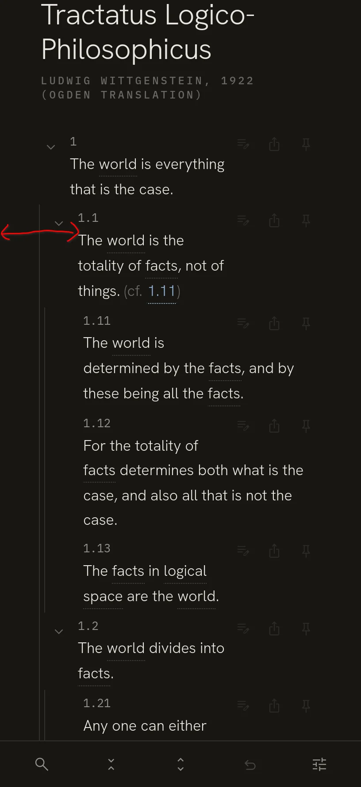

# Session 26: Mobile annotation saving

Claude Code · Content · 8 prompts · 279 words

[← Session 25](25-mobile-usability-round-one.md) · [All sessions](README.md) · [Session 27 →](27-full-book-import.md)

## Prompt 124

**Summary:** Asks how a user confirms/saves an annotation on mobile, since Enter serves that role on PC.

- **Phase:** Content
- **Human:** 29 words · ~44 s to write
- **LLM:** Opus 4.8 · Claude Code · 28 s
- **Outcome:** question asked, bug reported, feature rejected

### Prompt

> On mobile, how does the user confirm/save an annotation they wrote? On PC the user can press enter to achieve that. On mobile, are they supposed to tap elsewhere?

### Reply of Claude Code

Short answer: on mobile there's no explicit "save" button — the note is **autosaved continuously as they type**, and to *close* the editor they tap elsewhere (which blurs the textarea).

Here's the mechanism in `AnnotationNote.tsx`:

- **Autosave (the real safety net).** Every keystroke schedules a debounced commit 600ms later (`handleChange` → `onCommit`, `AUTOSAVE_DEBOUNCE = 600`). So the text is persisted to localStorage regardless of how the editor is dismissed — nothing is lost even if they navigate away. The footer literally says "autosaved · N left" (line 98).

- **Closing the editor = blur.** `onBlur={handleBlur}` commits the draft and calls `onStopEdit` (lines 64–68, 93). On mobile, tapping anywhere outside the textarea blurs it, which commits and closes. So yes — tapping elsewhere is the intended gesture.

- **Enter.** The `handleKeyDown` (lines 71–76) treats Enter (without Shift) as confirm-and-close. On a mobile soft keyboard the return key would trigger this same path — but that's actually a bit awkward on mobile, since a user often wants Enter to insert a newline in a multi-line note (Shift+Enter isn't reachable on most phone keyboards).

The footer (lines 96–112) only contains the autosaved/char-count meta and a **delete** button — there's deliberately no "Done"/"Save" affordance, because the design leans entirely on autosave + blur.

So the honest picture: it works (data is safe via autosave, and tap-elsewhere dismisses), but there's no *discoverable* mobile confirm action — a user might reasonably not know how to close the keyboard/editor, and the Enter-key behavior is arguably wrong for phones. If you want, I can add an explicit "Done" button that shows only in the mobile/inline (non-margin) layout, which would make the confirm gesture obvious without changing the desktop experience.

## Prompt 125

**Summary:** Drops the prior question and instead asks for a mobile-only layout change: put the statement number on its own row above the text, to save indentation space for deeply nested statements.

- **Phase:** Content
- **Human:** 46 words · ~1 min to write
- **LLM:** Opus 4.8 · Claude Code · 6 min 27 s · +215 −6 lines
- **Outcome:** feature rejected, feature built, constraint, verification

### Prompt

> Never mind about that for now. Another mobile refinement: only on mobile, have the statement's number (e.g. "1.12") be on its own row, and the statement's text start below it. This saves a lot of indentation space and prevents the deeply-nested text from becoming too narrow.

### Reply of Claude Code

The change is implemented and passes the checks that don't need a browser.

##### What I changed

Number now stacks above the text **on mobile only**; desktop is untouched. Three small edits:

1. **`src/components/StatementRow.tsx`** — wrapped `.row-num` + `.row-text` in a new `.row-body` span (grouping only, no logic change).
2. **`src/styles/reading.css`** — `.row-body { display: contents }` so on desktop the number and text stay direct flex siblings, byte-for-byte the same layout as before.
3. **`src/styles/mobile.css`** (inside the existing `≤719px` block) — `.row-body` becomes a `display:block` flex item and `.row-num`/`.row-text` become blocks, so the number sits on its own line with the text flowing full-width below it.

Because `.row` stays a single, non-wrapping flex line (`[rails] [toggle] [row-body]`), the depth rails still `stretch` the full row height — no rail breakage, and the top-right action cluster still clears the text via the existing spacer.

**Verified:** `npm run build` (tsc typecheck + vite) passes; `npm test` → 107/107 pass.

##### What I couldn't verify: the screenshot pass

The `verify` skill drives a real browser, but the nono sandbox doesn't grant the Playwright browser cache, so Chromium can't launch here:

```
nono why --path ~/.cache/ms-playwright --op read
DENIED
  Reason: path_not_granted
  Details: Path is not covered by any capability: ~/.cache/ms-playwright
  Suggested fix: --read ~/.cache/ms-playwright
```

To get the mobile/desktop screenshots, you'd need to grant that path. Two options:

- **Option A (quick, one-off):** exit and restart the session with the path allowed:
  ```
  nono run --allow ~/.cache/ms-playwright -- claude
  ```
- **Option B (persistent):** I can draft a nono profile that extends your active one with read access to `~/.cache/ms-playwright`, so future sessions can run the browser-based `verify` skill without re-granting. Say the word and I'll draft it (writes to `profile-drafts/`, which you then promote).

The change is low-risk and CSS-only, so this is a nice-to-have visual confirmation rather than a blocker — but happy to do it once the path is granted. Want me to go with A or B, or leave verification here?

*The app after this change (screenshot, not included): The app on a phone: each statement number, such as 1.11, sits on its own line above its text. The text then runs the full width below it. The bottom bar shows five icons.*

## Prompt 126

**Summary:** Wants the left-right margins of the book's main text (excluding intro/title) reduced on mobile.

- **Phase:** Content
- **Human:** 20 words · ~30 s to write
- **LLM:** Opus 4.8 · Claude Code · 1 min 22 s · +8 −1 lines
- **Outcome:** UX improved, decision

### Prompt

> Also decrease the left-right margins of the main text of the book (not the intro and title parts) on mobile.

### Reply of Claude Code

Done. The change is CSS-only, in the mobile (`≤719px`) block of `src/styles/mobile.css`:

- Reduced `.app-root` side padding from `10px` → `4px`, so the statement rows sit close to the screen edges and gain ~6px of text width on each side.
- Added `.reading-col > header { padding: 0 6px }` so the title and intro block keeps its previous, roomier `~10px` inset — only the main text (the `<section>` of rows) got tighter.

This works because `ReadingColumn.tsx` already separates the two: title/intro/meta live in `<header>`, and the statement rows live in the following `<section>`. Build passes.

Same caveat as before: I can't take confirming mobile screenshots because the sandbox blocks the Playwright browser cache. If you want the visual check, restart with `nono run --allow ~/.cache/ms-playwright -- claude` (or I can draft a persistent profile), and I'll verify both this and the number-stacking change together.

## Prompt 127

**Summary:** Reports that the requested margin decrease did not take effect at all, pointing to a screenshot with a marked-up arrow showing the problem area.

- **Phase:** Content
- **Human:** 40 words · ~1 min to write · 1 image
- **LLM:** Opus 4.8 · Claude Code · 10 min 12 s · +27 −16 lines
- **Outcome:** bug reported, correction, research, constraint

### Prompt

> @"Screenshot 2026-07-24 at 11-02-32 The Foldable Tractatus.png" 
>
> I see no decrease at all in the padding around the main text. It's exactly as before. I showed you what I mean in the attached image by drawing a red double arrow



### Reply of Claude Code

Now the request is crystal clear: **just narrower blank bands left and right of the text**, and revert my restructure. Let me first check the compiled CSS order, because I suspect `global.css`'s own `.app-root { padding: 0 40px }` (defined *after* the `@import 'mobile.css'`) is overriding the mobile padding — which would explain why reducing it "did nothing."

## Prompt 128

**Summary:** Asks to commit current work, then fix the padding issue: halve the width of the blank vertical bands beside the text via a padding/margin change only, without touching element positioning, per the attached annotated screenshot.

- **Phase:** Content
- **Human:** 96 words · ~2 min to write · 1 image
- **LLM:** Opus 4.8 · Claude Code · 7 min 41 s · +33 −0 lines
- **Outcome:** constraint, tooling, bug reported

### Prompt

> Commit, then tackle the following feedback.
>
> @"Screenshot 2026-07-24 at 11-02-32 The Foldable Tractatus.png" 
>
> I see no decrease at all in the padding around the main text. It's exactly as before. I showed you what I mean in the attached image by drawing a red double arrow.
>
> Note that I don't want you to further change the relative positioning of elements. I'm just asking you to narrow the vertical empty bands to the left and right of the text to half their currend width. It's nothing other than a padding or margin change. SHould be super simple


### Reply of Claude Code

The browser launches now but Chromium can't run under this sandbox (`Permission denied` reading `/proc/self/maps` → GPU/sandbox fatal). So no live screenshots this session. Let me at least calibrate the scale of your screenshot so my CSS reasoning maps to what you actually see.

## Prompt 129

**Summary:** Points out that the visible bands are simply the 40px padding applied at the app-root level, as a diagnostic clue.

- **Phase:** Content
- **Human:** 14 words · ~21 s to write
- **LLM:** Opus 4.8 · Claude Code · 14 s
- **Outcome:** question answered, bug fixed, docs written

### Prompt

> The bands I see are simply the 40px padding applied at the app-root level

*The app after this change (screenshot, not included): The app on a phone: the nested statements, with the number on its own line above the text. The blank bands at the left and right of the text are narrower.*

## Prompt 130

**Summary:** Tells the agent to drop the chromium/playwright approach it was pursuing.

- **Phase:** Content
- **Human:** 5 words · ~8 s to write
- **LLM:** Opus 4.8 · Claude Code · 8 min 18 s · +38 −33 lines
- **Outcome:** process, decision

### Prompt

> forget about chromium and playwright.

### Reply of Claude Code

Done. Committed both the earlier work and this fix.

##### What was actually wrong

The band was the `.app-root` **40px** padding, exactly as you said — and the reason my first attempt did nothing is a cascade bug I hadn't spotted: `global.css` does `@import './mobile.css'` at the top and then **re-declares `.app-root` / `.reading-col` further down the same file**. Since those global-body rules come later in source order at equal specificity, they beat everything in `mobile.css`. So every `.app-root` override in `mobile.css` — including the one I added — was dead code that never applied. Your mobile view was using the desktop 40px the whole time.

##### The fix (committed `86d7073`)

Moved the responsive shell padding into `global.css` where it wins, scoped to `≤719px`:

- `.app-root` side padding: **40 → 20px** on mobile → the statement rows' side band is halved.
- `.reading-col > header` gets **+20px** on mobile → the title/intro block keeps its original 40px inset, so only the main text moved.
- Removed the now-dead `.app-root` / `.reading-col` / header rules from `mobile.css` and left a note explaining why shell padding lives in `global.css`.

Desktop is byte-for-byte unchanged (I reverted my interim 20px base change), and it's purely a padding change — no relative repositioning. Build + all 107 tests pass.

One honest caveat: I still can't render a screenshot to confirm — Chromium won't run under this sandbox (it needs `/proc/self/maps`, which is blocked even with the browser installed locally). But this time the change targets precisely the 40px you identified, and the root-cause explanation accounts for why you saw no movement before. If 20px still feels too wide on your phone, say the word and I'll drop it further — it's now a one-number change in that `@media` block.

*Meanwhile: [prompt 131](27-full-book-import.md#prompt-131) in session 27 (Claude Code).*

## Prompt 132

**Summary:** Confirms the fix is fine but wants it reduced a bit more, and additionally wants top-level statement numbers vertically aligned with the left edge of the 'Tractatus Logico-...' title.

- **Phase:** Content
- **Human:** 29 words · ~44 s to write
- **LLM:** Opus 4.8 · Claude Code · 10 min 10 s · +12 −1 lines
- **Outcome:** verification, feature designed, process, question answered, UX improved, bug reported

### Prompt

> I checked and it's fine, though I'd reduce it a bit more. I want the top-level statements to be vertically aligned on the left with the title "Tractatus Logico-..."

### Reply of Claude Code

Before I change this, I want to get it right in one shot (I can't screenshot to check here). "Align the top-level statements with the title" has two readings that need different implementations, because each statement has a fold **˅ chevron** sitting to the left of its **number**:

**Questions of the AI:**

1. Which part of a top-level statement should line up exactly under the first letter of the 'Tractatus Logico-...' title?
   - Options: The number · The fold chevron
   - **Answer:** The number

Done and committed (`89b0a08`).

##### What changed (mobile only, `src/styles/mobile.css`)

1. **Rows now share the header's 20px inner indent** — `--indent-base: 20px` on mobile. Since the header pads its title/intro by 20px too, a depth-0 number now lands at the same left position as the "Tractatus Logico-…" title.
2. **The fold chevron hangs in the left margin** — `.row-toggle { margin-left: -34px }` (its 26px width + the 8px row gap). This cancels the horizontal space the toggle would otherwise add, so the number/text start flush under the title instead of being pushed ~18px to its right. The chevron keeps its full 26px tap target.
3. **Inline notes realigned** to the same column (`margin-left: 39px → 20px`).

Net effect: the number/text column moves from ~58px to ~40px from the edge — which also covers your "reduce it a bit more," since aligning the number to the title is what pulls the whole text block leftward. Deeper statements stay progressively indented via the depth rails, as before. Desktop is untouched. Build + 107 tests pass.

Two honest caveats, since I still can't render a screenshot here:
- The chevron's box sits at roughly 6px from the screen edge (its visible glyph centered ~19px in). If it reads as too close to the edge or slightly detached from the number, that's a one-line tweak to the `-34px` value.
- I left the "peek" (reveal-N) rows with their icon inline at the same 40px column rather than hanging it — they aren't numbered statements, so it seemed right to leave them. Say the word if you'd like them to match.

*The app after this change (screenshot, not included): The app on a phone: the book title "Tractatus Logico-Philosophicus" and the top-level statement numbers 1 start at the same left edge. Nested statements are indented slightly.*

---

[← Session 25](25-mobile-usability-round-one.md) · [All sessions](README.md) · [Session 27 →](27-full-book-import.md)
