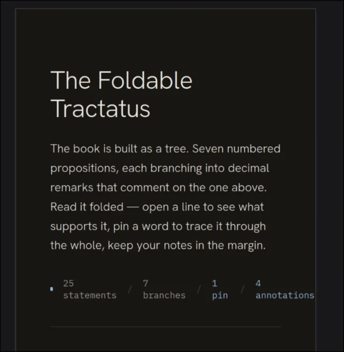
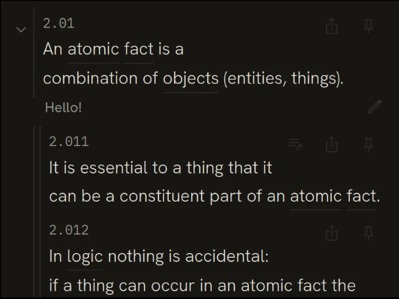
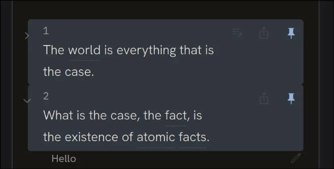

# Session 28: Screenshot-driven mobile fixes

Claude Code · Content · 7 prompts · 219 words

[← Session 27](27-full-book-import.md) · [All sessions](README.md) · [Session 29 →](29-curated-term-index.md)

## Prompt 138

**Summary:** Fix a mobile overflow bug by moving the pin/annotation counts to a second header line, and ask why two specific sentences are breaking lines awkwardly given available space

- **Phase:** Content
- **Human:** 118 words · ~3 min to write · 2 images
- **LLM:** Opus 4.8 · Claude Code · 30 s
- **Outcome:** bug reported, research

### Prompt

> To mobile UI issues:
> 1. @image.png 
> As you can see, on mobile when I pin one or more statements the stats row in the header section overflows and pushes the page's width beyond the screen's width. Fix that by having the number of pins and annotations in a second line below statements and branches.
>
> 2. @"image copy.png" 
> Here is a newline issue: why in 2.01 does it break the line and push "combination" to the second line while there is still plenty of space for it? And in 2.011 it breaks the line at "that it" and "can be a" is on the second line, whereas at least those 3 words could have remained in the first line.





### Reply of Claude Code

Login expired · Please run /login

## Prompt 139

**Summary:** Uninterpretable greeting with no request content

- **Phase:** Content
- **Human:** 1 word · ~2 s to write
- **LLM:** Opus 4.8 · Claude Code · 0 s
- **Outcome:** 

### Prompt

> hey

### Reply of Claude Code

Login expired · Please run /login

## Prompt 140

**Summary:** Asks the agent to proceed with whatever work was previously agreed, without specifying which task

- **Phase:** Content
- **Human:** 1 word · ~2 s to write
- **LLM:** Opus 4.8 · Claude Code · 3 min 59 s · +85 −18 lines
- **Outcome:** bug fixed, correction, tooling

### Prompt

> continue

### Reply of Claude Code

Good news — this is already solved by an existing profile, it just isn't active in this session.

**Diagnosis (verbatim):**
```
DENIED
  Reason: path_not_granted
  Details: Path is not covered by any capability: ~/.cache/ms-playwright
  Suggested fix: --read ~/.cache/ms-playwright
```

Your `~/.config/nono/profiles/claude-local.json` **already** grants `$HOME/.cache/ms-playwright` and `$HOME/.npm` read-write (line 9) — with a comment noting item (11)/(12) exist precisely so Playwright works. But this session's allowed-paths list doesn't include them, so **this session wasn't launched under `claude-local`** (it's on the base `claude` pack profile). No new profile draft is needed.

Your options to enable the screenshot verification:

- **Option A (quick, this session's need only):** restart with the paths allowed —
  ```
  nono run --allow ~/.cache/ms-playwright --allow ~/.npm -- claude
  ```
- **Option B (the intended fix):** relaunch under the profile that already covers this —
  ```
  nono run --profile claude-local -- claude
  ```
  (or whatever launcher normally selects `claude-local`).

##### Meanwhile — the changes are complete

All three edits are done and `tsc --noEmit` passes. Here's what changed and why it addresses each issue:

**1. Stats row overflow (`image.png`)** — `src/components/ReadingColumn.tsx` + `reading.css` + `mobile.css`
- The stats are now two groups: `[• N statements / N branches]` and `[N pins / N annotations]`, with the between-group `/` separator hidden on mobile.
- `.rc-meta` became a wrapping flex; on mobile (`≤719px`) it switches to `flex-direction: column`, so pins/annotations always drop to a **second line** below statements/branches — the header can no longer be pushed wider than the screen no matter how high those counts climb. Desktop is unchanged (still a single line with all `/` separators).

**2. Premature line breaks (`image copy.png`)** — `src/styles/reading.css`
- `.row-text` was `text-wrap: pretty`, which *balances* the paragraph rag — that's what pulled "combination" (2.01) and "can be a" (2.011) down to a new line while the line above still had room. Changed to `text-wrap: auto` (greedy): each line fills as much as it can before wrapping, which is the behavior you described wanting.

If you'd rather I not verify with screenshots, I'm confident in these — but relaunching under `claude-local` will let me confirm them visually. Want me to proceed once you've restarted, or leave it here?

The dev server is running at `localhost:5173` if you'd like to eyeball it in your own browser (resize to a narrow width and pin a statement or two).

## Prompt 141

**Summary:** Confirms the stats-row overflow fix worked, reports the line-break issue is still unsolved, and instructs the agent not to use playwright or take screenshots

- **Phase:** Content
- **Human:** 30 words · ~45 s to write
- **LLM:** Opus 4.8 · Claude Code · 6 min 16 s · +13 −22 lines
- **Outcome:** constraint, verification, bug fixed, correction

### Prompt

> DOn't attempt to use playwright or take screenshots.
>
> I verified the stats row overflow fix: OK
>
> As for the line breaks, they still look exactly as before. Problem not solved.

### Reply of Claude Code

My first attempt was wrong — I misdiagnosed the line-break issue as `text-wrap: pretty`. Thanks for testing and pushing back. The real cause was mobile-specific, and I've now fixed it.

##### What was actually happening (issue 2)

Your screenshot is the **mobile** layout — the giveaway is `2.01` sitting on its own line *above* the text. In that layout, `.row-text` had a `float: right; width: 104px; height: 24px` spacer (`.row-actions-spacer`) at the start, reserving a 104px-wide gap so the **first text line** flows around the floating share/pin action icons in the corner.

That's why only ~4–5 words fit on line one and *everything* after wrapped — the break was always at the artificially-shortened first line, which is exactly what you saw in both 2.01 ("combination") and 2.011 ("can be a"). `text-wrap` had nothing to do with it.

But the icons don't actually need the *text* line — they sit at `top: 8px`, essentially on the **number's** line (`2.01`), which is short and left-aligned with empty space to its right.

##### The fix

- **Retired the first-line spacer** — removed the dead `.row-actions-spacer` element and its CSS entirely.
- **Lifted the icon cluster** from `top: 8px` to `top: 3px` so the 20px icons sit within the ~21px number band and clear the text line below.
- Text now spans the **full column width on every line** on mobile, with greedy wrapping (`text-wrap: auto`) so each line fills before wrapping — matching what you expected.
- Reverted the base `.row-text` back to its intentional `text-wrap: pretty` (desktop typography unchanged).

Issue 1 (stats overflow) you already confirmed — that's untouched.

`tsc --noEmit` clean; all 107 repo tests pass (the one failure was in an unrelated `.claude/worktrees/full-text-import` worktree). I didn't screenshot per your instruction — please eyeball 2.01/2.011 on mobile to confirm the first line now fills.

*The app after this change (screenshot, not included): The app on a phone: the info line wraps, with "25 statements / 7 branches" on the first line and "1 pin / 2 annotations" on the second. Statement 1.11 is pinned, and two short notes show under their statements.*

## Prompt 142

**Summary:** Requests a git commit of the current work

- **Phase:** Content
- **Human:** 1 word · ~2 s to write
- **LLM:** Opus 4.8 · Claude Code · 18 s
- **Outcome:** tooling

### Prompt

> commit

### Reply of Claude Code

Committed as `4f92af9`. Both fixes are in one commit; the screenshots and the `.claude/worktrees/` directory were left untracked.

## Prompt 143

**Summary:** Reports a new mobile bug where pinned-item highlight boxes misalign with chevron toggles, and directs making mobile highlights full-width with square corners while leaving desktop unchanged

- **Phase:** Content
- **Human:** 67 words · ~2 min to write · 1 image
- **LLM:** Opus 4.8 · Claude Code · 3 min 1 s · +71 −1 lines
- **Outcome:** bug reported, decision, bug fixed, process

### Prompt

> New issue, probably due to your earlier shrinking of the padding: @"image copy 2.png" 
>
> As you can see, on mobile now the highlight box for pinned items doesn't properly include the chevron toggle buttons, which sit awkwardly on its border. To solve this, make the highlights on mobile stretch the whole width of the screen, no rounder borders. Keep desktop UI the same as it is now.



### Reply of Claude Code

Build is clean (typecheck passed, CSS compiled).

The change is done — `src/styles/mobile.css` only. On mobile, `.row` now bleeds to both screen edges with square corners, so the margin-hung chevron sits inside the pinned wash instead of on its border. The `+20px` compensating padding on each side (and `right: 26px` on the action cluster) keeps the number, text, chevron, and icons exactly where they were, and the `-40px` margin / `+40px` padding balance means no horizontal scroll. Desktop is untouched — the new rules live entirely inside the `@media (max-width: 719px)` block.

*The app after this change (screenshot, not included): The app on a phone: the pinned statement 1.11 has a pale highlight that spans the full screen width, with square corners. The pin icon at the right is filled.*

## Prompt 144

**Summary:** Requests a git commit of the current work

- **Phase:** Content
- **Human:** 1 word · ~2 s to write
- **LLM:** Opus 4.8 · Claude Code · 10 s
- **Outcome:** tooling

### Prompt

> commit

### Reply of Claude Code

Committed as `862e484` — just `src/styles/mobile.css`.

---

[← Session 27](27-full-book-import.md) · [All sessions](README.md) · [Session 29 →](29-curated-term-index.md)
